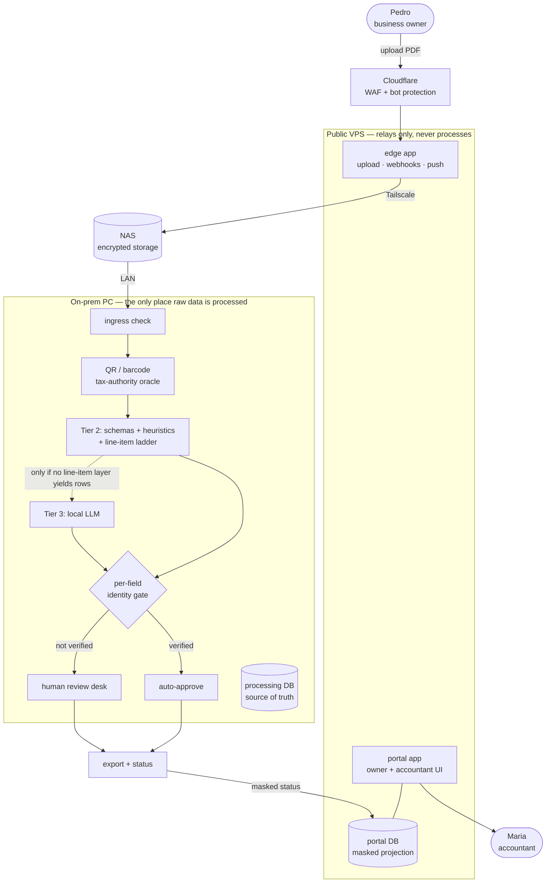

**English** · [Magyar](../hu/00-at-a-glance.md) · [↑ README](../../README.md)

# At a glance

## The system on one picture

## Fourteen decisions that define it

One line each; the full record — context, rejected alternatives, consequences — is in
[Decision records](a-decision-records.md).

| ADR | decision | why | price |
|---|---|---|---|
| [01](a-decision-records.md#adr-01--no-cloud-processing) | **No cloud.** Raw invoices are processed only on an on-prem PC. | Data sovereignty is the promise to small businesses and accountants. | Three machines, local OCR and LLM; Cloudflare still reads uploads in transit. |
| [02](a-decision-records.md#adr-02--the-tax-authority-qr-code-is-the-oracle) | **The tax-authority QR code is the oracle** for header values. | A signed, state-reported source beats a model's confidence in itself. | Invoices without a QR (21 % of the golden set) have no oracle. |
| [03](a-decision-records.md#adr-03--tiered-extraction-the-local-model-last) | **Three tiers:** QR → schemas, heuristics and a line-item ladder → a local LLM last. | Cheap and deterministic first. | Three code paths to keep consistent. |
| [04](a-decision-records.md#adr-04--schemas-as-data) | **Schemas as data:** a country master plus one delta per invoicing program. | A new vendor layout is a YAML file, not code. | Coverage grows one program at a time. |
| [05](a-decision-records.md#adr-05--precision-first-never-guess) | **Never guess.** A missing value beats a wrong one. | Review catches a gap; a confident error reaches the accountant. | Lower automation — on purpose. |
| [06](a-decision-records.md#adr-06--a-per-field-identity-gate-strict-first) | **A per-field identity gate**, strict first, loosened only on evidence. | Trust is where the value is. | In the pilot configuration every invoice went to review. |
| [07](a-decision-records.md#adr-07--two-apps-on-the-public-server) | **Two apps on the public server:** a thin edge and the portal. | A compromised edge must not reach client-data logic. | Two deployables. |
| [08](a-decision-records.md#adr-08--three-databases-as-three-nodes) | **Three databases on three nodes;** the truth lives on the PC. | The public server can be lost without losing — or leaking — the truth. | A synchronisation bridge to design explicitly. |
| [09](a-decision-records.md#adr-09--layered-links-nothing-on-the-processing-site-exposed) | **Layered links,** nothing on the processing site exposed. | Each hop has one job. | Any layer down stops the flow (fallback: SSH pull). |
| [10](a-decision-records.md#adr-10--the-owner-pays-the-accountant-does-not--and-earns-no-commission) | **The owner pays; the accountant uses it free.** | She is the channel: one accountant brings her whole client book. | Two user groups, two interfaces. |
| [11](a-decision-records.md#adr-11--graduated-usage-pricing) | **€39/month + graduated usage** instead of packages. | Packages created a credit-hoarding trap. | Less predictable revenue. |
| [12](a-decision-records.md#adr-12--the-pii-gate-applies-to-the-builder-too) | **The PII gate applies to the AI that builds the system.** | The no-cloud promise must hold for the builder too. | Debugging on masked data only. |
| [13](a-decision-records.md#adr-13--the-money-path-split-by-responsibility) | **The money path split by responsibility:** Stripe collects, our ledger decides, a local program invoices. | A human approval changes the bill; that decision must be auditable where it is made. | Four systems to reconcile; built up to the CSV. |
| [14](a-decision-records.md#adr-14--the-pipeline-bridge-is-a-folder-contract-not-an-api) | **The pipeline bridge is a folder contract, not an API.** | The processing machine needs no open port. | Polling latency and marker files. |

## Four stories worth asking about

- **The bit-exact staircase** — how a 1,482-line task was cut down without changing a single output. → [Platform](09-platform.md#measured-then-repaired-step-by-step)
- **The 17-day silent backup failure** — 412 failure pings that nobody received. → [Infrastructure](08-infrastructure.md#backup-and-disaster-recovery)
- **The false zero** — a port scan that reported "clean" for the wrong reason. → [Security](07-security-and-isolation.md#the-perimeter--stated-then-measured)
- **The number that measured the wrong thing** — line-item rates taken on the lab extractor, not production. → [Metrics](b-metrics.md#the-measurement-lessons)
