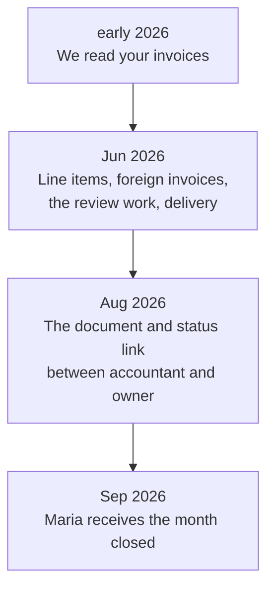

**English** · [Magyar](../hu/01-problem-and-market.md) · [↑ README](../../README.md)

# The problem and the market

> **In one sentence:** the header of a Portuguese invoice already reaches the state, so the value
> was in what does not — the line items and the documents nobody has collected yet — and the thesis
> moved four times as measurements and regulation sharpened that picture.

## The problem in three facts

1. **Accountants spend 20–30 % of their time chasing documents** from their clients — in the words
   of the president of their professional body [S1, S2].
2. **The state already has the header of every domestic invoice.** Through e-Fatura, issuer, buyer,
   date and VAT are reported automatically; the accountant can download them. **The line items are
   deliberately left out**, for personal-data protection [S3].
3. **The PDF is still the only source for part of the month:** small businesses may issue plain PDF
   invoices until the end of 2026, and foreign invoices never appear in e-Fatura.

So the value is not in reading the header. It is in what nobody else collects: the line items, the
foreign invoices, and the documents the accountant is still waiting for.
Sources S1–S4 are listed in [Metrics](b-metrics.md#sources).

## How the value thesis moved

| step | what we learned | consequence |
|---|---|---|
| **1 → 2** | Demand is proven — paying incumbents exist and charge for exactly this work. The risk is competition. But the document-AI specialists were moving up-market (one was acquired and went quote-only), leaving the small-accountant corner open. **And** the Portuguese e-invoice system already sends every domestic invoice's header and VAT to the state — the accountant gets it anyway. | Header extraction is not a product in Portugal. The wedge: line items, foreign invoices, the review labour, delivery into the accounting program. |
| **2 → 3** | The state **deliberately** does not collect line items — the tax authority's own e-Fatura leaflet cites personal-data protection [S3]; Portugal's system is consumer-oriented, and an itemised national database would profile the whole population. Hungary chose the opposite. | The line items are a gap by law, not by neglect. The position becomes the link between accountant and owner: documents, status, what is missing. Maturity path: intake tool → intake hub → compliance workflow. |
| **3 → 4** | The professional body's own number — fact 1 above — made the pain concrete. The leading accounting program already has a "missing invoices" request — after the month, by e-mail [S4]. | The service: *the month arrives closed* — what is expected has arrived; what arrived is read and checked; what nobody's list sees is flagged; all of it lands in her program. |

## The regulatory window

Small businesses may issue plain PDF invoices until the end of 2026; structured e-invoices with a
qualified signature are due from 2027 (Decree-Law 13-A/2025) — a deadline already postponed before. Foreign and consumer
invoices stay outside either way. The window was real, but closing.

Who uses the product, and why only one side pays → [Product and users](02-product-and-users.md).
