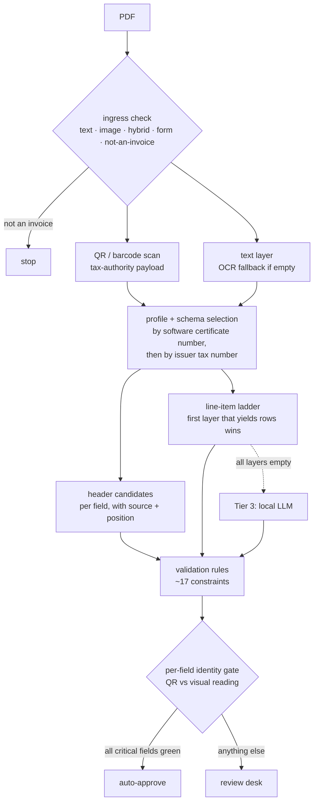

**English** · [Magyar](../hu/02-parsing-engine.md) · [↑ README](../../README.md)

# The parsing engine

> **In one sentence:** cheap, deterministic readers first, a local model only as the last resort —
> and every value is judged against an independent source before anyone may trust it.

## The pipeline

## Stage by stage

| stage | what it does | why this way |
|---|---|---|
| **Ingress check** | Classifies the file (text / image / hybrid / form) and stops early only on a confident "not an invoice". | Reject garbage before it costs OCR time; everything else is information, not a gate. |
| **QR scan (Tier 1)** | Reads the Portuguese tax-authority QR at 300 DPI, with fallbacks for embedded images. The payload carries issuer and customer tax numbers, document type, date, number, ATCUD, VAT bands and totals. | The QR is signed and reported to the state — it is the **oracle**, the one source the engine does not have to believe on trust. |
| **Text + OCR** | Text layer first; Tesseract only when the text layer is (almost) empty. | Most invoices are born digital; OCR is the expensive exception. |
| **Schema selection** | The QR carries the invoicing software's certificate number; it selects a *delta* schema on top of the country *master*. Without a certificate, the issuer's tax number routes it. | One invoicing program = one layout family. Adding a vendor is a YAML file. |
| **Header candidates** | Each field collects candidates with their source (QR, schema, heuristic) and position on the page. | Keep alternatives until the evidence decides — never pick early. |
| **Line-item ladder (Tier 2)** | Up to seven layers, in order: schema-defined box → ruled table → whitespace table → Tabula (the original four) → column geometry → graphic table → table-transformer model behind a flag (added later; the function's docstring still describes the original four). The first layer that yields rows wins; continuation rows are merged and subtotal rows dropped. | Cheapest reliable method first, and a clear audit of *which* method produced each row. |
| **Tier 3 (local LLM)** | Only if every ladder layer came back empty: a small local model (Qwen2.5 3B via Ollama) with a JSON schema, 120 s timeout, and a circuit breaker after three consecutive failures. | No cloud. The model is the last resort, not the engine. |
| **Validation rules** | Fourteen registered constraints: VAT triangle (net + tax = gross), tax-number checksum and direction, date range, ATCUD and QR consistency, line-item maths horizontally and vertically, VAT-rate validity, page limit. Outcomes: auto-approve, review one field, review all, reject. | Business rules as code, each one named and testable. |

## The identity gate — where trust is decided

Every field has an entry in a **field catalogue**: its canonical name, its QR slot, its visual
slots, its type, whether it is critical, and how it can be verified:

| class | verified by | example |
|---|---|---|
| **a** | an independent source (QR, checksum) | tax numbers, totals, date, ATCUD |
| **b** | arithmetic between fields | net + VAT = gross |
| **c** | nothing — read-only | supplier name, free text |

For each field the engine compares the QR reading with the visual reading (amounts within 2 cents)
and gives it a band:

- 🟢 **green** — the two independent sources agree;
- 🟠 **amber** — one source only, or a soft disagreement;
- 🔴 **red** — a hard rule is broken (veto).

The document's confidence is the **minimum over its critical, verifiable fields** — one doubtful
total is enough to stop it. No verifiable critical field means confidence zero.

**For the pilot, automatic approval was switched off in code.** Every invoice went to the review
desk, and the gate decided *what the operator has to look at*, not *whether anyone looks*. The plan
was to loosen field by field, only on measured evidence — start strict, loosen only where measurements allow.

## The review desk

The desk shows the operator one field at a time, ordered by risk:

- **green fields are skipped** — the cursor does not even stop;
- for tax numbers and totals the input cell starts **empty**, so the operator types what she sees
  instead of confirming what the machine suggested (anti-anchoring);
- on commit, **the same validators that judged the machine judge the human** — a tax number typed
  into the wrong party's field is refused unless explicitly overridden.

The operator's time per invoice, not the auto-approve rate, was the north-star metric: as long as
trust is being built, everything is reviewed, so the question is how fast.

## The measurement lab

- A **golden set** of 203 annotated invoices (public sample invoices, not client data).
- A **QR-anchored metric** for line items: do the extracted lines add up to the invoice's net
  total? Each invoice ends as *reconciled*, *sum off*, or *empty*.
- An eight-phase improvement loop — orient, measure, triage, diagnose, spike, fix, verify, record —
  where every change is kept or dropped by measured effect.
- ⚠️ **What the numbers measure.** The line-item rates in this repository (19 % in May, 10.3 % in
  August) were measured on the **lab extractor** — a table-recognition model evaluated as the
  candidate next layer — not on the production ladder above. I found this mismatch myself, late;
  it is recorded as one of the lessons on measurement.

## Designed vs built — honestly

| designed | built |
|---|---|
| layout fingerprinting as a fallback when no certificate number is found | the component and its cache table exist; production never calls them |
| the table-recognition model as a ladder layer | lab only |
| automatic approval above a confidence threshold | disabled for the pilot; an opt-in "safe auto-approve" path existed behind a flag |
| LLM circuit breaker as a temporary cut-out | it latches for the life of the process |

## Read more

Original design documents (Hungarian): parsing tiers, schema strategy, line-item extraction,
the identity → review contract, the review-desk framework.
