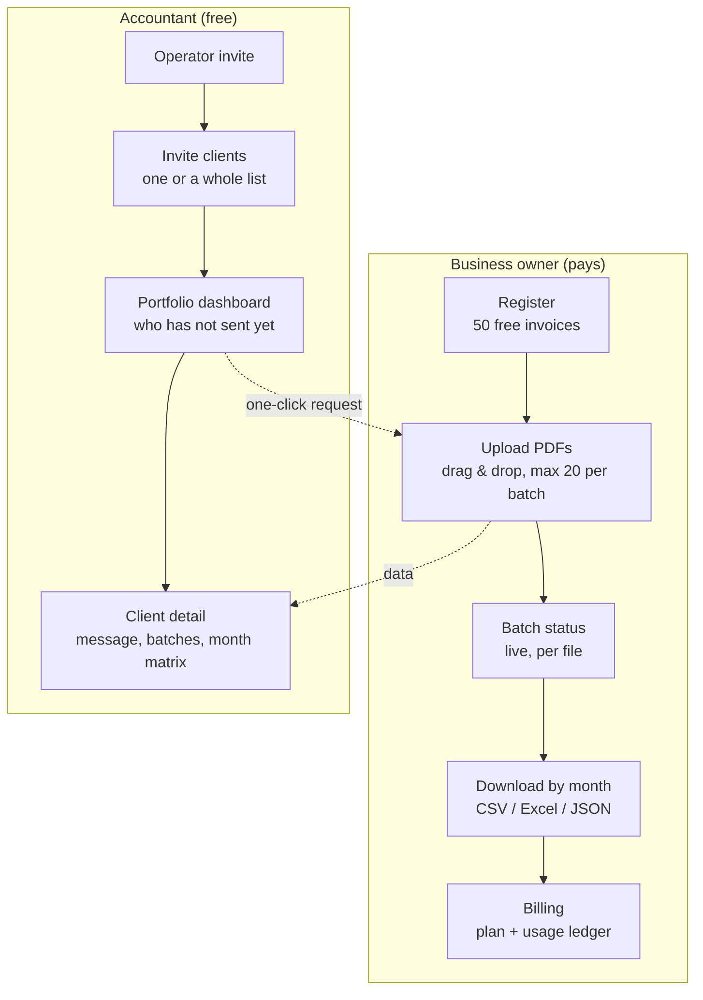

**English** · [Magyar](../hu/03-client-interface.md) · [↑ README](../../README.md)

# The client interface, screen by screen

> **In one sentence:** behind the engine there was a complete, working product for two kinds of
> user — a business owner who uploads and pays, and an accountant who sees all her clients at once —
> designed so that neither of them ever needs to call support.

The site was taken offline after the project closed. These screenshots were captured from the live
system on 13 October 2026, with demo accounts; every company name, tax number, e-mail address and
file name in them has been replaced with a synthetic one.

## The idea in one picture

*Phil* is an invoice. On the left he is what the owner has today: a PDF nobody can use. On the
right he is what the accountant receives: structured data. The whole product promise fits in this
before-and-after, so the landing page opens with it, and Phil reappears only where the process
completes. The illustration style — flat, a fixed palette from the design tokens, Phil always in
the foreground and framed — is written down as a short style guide, so new images stay consistent.
The concept and the style rules are mine; the images were generated with Nano Banana and Claude Design.

## Two users, two journeys

The two sides meet in one place: the accountant asks for the month's invoices with one click, and
the owner's upload lands, verified, in her client view. The review desk in between is an internal
operator tool, described in the [Trust](05-trust.md#the-review-desk) chapter.

## The public side

| | |
|---|---|
|  |  |
| **The owner's landing page.** One question ("Still typing invoices by hand?"), one offer (50 free invoices), three promises: every invoice checked by a person, results next morning, no public cloud. | **A separate landing page for accountants**, reached only by invitation link (not indexed). It speaks about her clients, not about her invoices. |
|  |  |
| **"Do you recognise this?"** — the owner's day in four cards, then the three steps. The answer is framed as a service, not another piece of software. | **Security that is more than a badge**, and an honest comparison with OCR software and with doing it by hand. |

## The owner's side

| | |
|---|---|
|  |  |
| **Dashboard.** How it works in three steps, the processing window (sent by 19:00, delivered by 09:00), trial status, recent batches with their state. | **Upload.** Drag and drop, PDF only, 50 MB per file, 20 files per batch; anything outside the rules is rejected on the spot, with the reason. |
|  |  |
| **A batch.** Progress, rejected files with a resend button, each file with its state and confidence, and an event history that refreshes every five seconds while processing. | **Results.** Organised by month of issue, one file per format. The originals are deleted 48 hours after processing; the results stay for 12 months — said on the screen, not only in the terms. |
|  |  |
| **Billing.** The plan, the graduated per-invoice price, and an immutable ledger month by month — the same ledger the money path writes ([billing](10-billing.md)). | **Team.** Up to five members, a permissions table, ownership transfer with confirmation, and a note that the accountant is *not* added here. |

**Legal documents** in one place: privacy, cookies, GDPR rights, terms, and the data-processing
agreement as a downloadable PDF. A cookie banner asks for consent before any optional cookie
(payments, push notifications).

## The accountant's side

| | |
|---|---|
|  |  |
| **Portfolio dashboard.** All clients on one screen, sorted by who needs her; the next VAT deadline with the days left; one click to ask a late client for invoices — the platform notifies them, no phone calls. | **Client detail.** A message box to the client, the batches, and a month × format download matrix that marks a file *changed* if it was regenerated after she downloaded it. Analytics stay locked until the client consents. |

## Design decisions

| decision | why | cost |
|---|---|---|
| **A service, not software** — the user uploads and downloads, nothing to configure | the buyer is a micro-business owner with no time to learn a tool; the software itself was never for sale — the service was, which is also why it could run on own hardware | every invoice needs a processing pipeline and a review behind it |
| **The processing window is on every screen** (by 19:00 → by 09:00) | sets the expectation once, so "where is my data?" never becomes a support ticket | no instant results, even when the engine could deliver them |
| **Nothing fails silently** — a locked widget says *why* and offers the next step; clients without consent are listed by name, not counted as zero | the accountant must trust what she does *not* see as much as what she sees | more states to design and test per screen |
| **One file per format, no ZIP** | nobody needs CSV, Excel and JSON at once; the accountant needs the one her software imports | more download buttons |
| **Portuguese only for users; the landing page also in English** | the market is Portugal; a full translation layer was not worth it before the first customer | the app has no i18n framework — a second language would be a refactor |
| **Retention and deletion stated in the interface** (48 h originals, 12 months results) | the privacy promise is believable only where the user is looking | the promise binds the pipeline — see [data path](06-data-path.md) |

## How it was tested

The interface was walked end to end by **persona-driven browser agents**: three owner–accountant
pairs, each agent knowing only "this extracts invoice data", each on a fresh account, scoring a
pilot-readiness score (target: every pair ≥ 80, no blocking bug). Seven rounds ran between June and July
2026. The first real round found **15 bugs, 4 of them blocking**. The core journey — invitation,
registration, consent, upload, countdown — was the strongest part in both personas' reports; the
breakages were at the edges (a stale test account, a failing checkout, internal labels leaking into
an export). **The readiness target was never met.**

## Designed vs built — honestly

| designed | built |
|---|---|
| the web portal on a phone | desktop-first; on a phone the owner's screens overflow sideways. A small companion app for upload and push notifications was started alongside |
| "results stay for 12 months", shown on the results screen | the 48-hour deletion of originals was built; the sweep that would enforce the 12 months stayed a design ([data path](06-data-path.md)) |
| a second interface language | Portuguese only; English on the landing page |
| persona QA score ≥ 80 before go-live | 7 rounds run, target not met |
| client-side analytics for the accountant (VAT summary, missing invoices, top suppliers, cost trend) | built and consent-gated; never seen with real consent |

**Size:** 40 screens (21 public, 12 owner, 7 accountant), about 13.7k lines of JSX and 9.4k lines
of CSS, 119 commits between March and August 2026.
