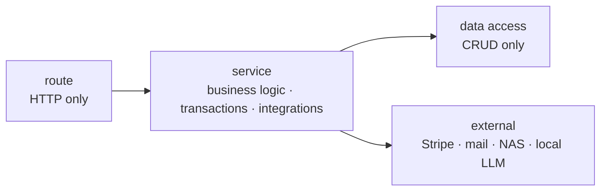

**English** · [Magyar](../hu/04b-platform.md) · [↑ README](../../README.md)

# The platform

> **In one sentence:** a layered service platform around the engine — and a running fight to
> keep the layers honest while an AI team wrote the code at speed.

## The layering rule

- **Routes** declare the endpoint, validate input, inject dependencies, call a service, raise 4xx.
- **Services** own the business decisions, the transactions, the retries and every external call.
- **Data access** does create/read/update/delete — nothing else.
- Dependencies are injected, not imported as globals, so a service can be tested without a server.

**Why it mattered more than usual:** AI agents write a working endpoint fastest by putting the
query straight into the route. Fast, and wrong — business rules end up scattered across 70 files.

## Measured, then repaired step by step

An architecture drift audit in May 2026 checked the code against the rule. Re-measured for this
record: **55 of 70 route files** still talk to the database directly — the drift was larger than
the audit's first estimate.

The response was a staircase, not a rewrite:

| step | what | status |
|---|---|---|
| 1–4 | preparatory moves, ending with the ingress check extracted into its own package | done |
| pilot-must | the billing retry loop taken out of the pipeline — billable events now go to a ledger service | done |
| 5a | baseline for the Portuguese pipeline: 10/10 golden invoices bit-exact before touching anything | done |
| 5b | the 418-line persistence block moved from the task into its own service — the task shrank from 1,482 to 1,106 lines, outputs bit-exact | done |
| 6 | the remaining route-level drift | deferred until after the pilot |
| — | **new code:** every new route must follow the rule, with a devil's-advocate review at plan time and before commit | enforced |

The point is not the count; it is the order. Freeze the behaviour (bit-exact baseline), move one
block, prove nothing changed, commit — then the next.

## Identity and access

- **One scope resolver** answers every "may this user see this client?" question.
- It was introduced under **characterisation tests**: 14 tests capturing the old behaviour plus
  3 differential-oracle tests comparing old and new answers — zero regressions at switch-over.
- Users exist in three databases; an **identity map** pins one person to one identity across them.
- Cross-tenant tests target the accountant paths explicitly (access by link, profiling with consent).
- The open items were written down as a ranked list (consent as a hard gate rather than a
  formality, fail-closed on identity mismatch, a database-level role constraint) — and the
  database bridge that depended on them was blocked until they were decided.

## The surfaces

| surface | for | stack |
|---|---|---|
| client web app | Pedro (owner) and Maria (accountant) — 34 pages | React 19, Vite |
| internal web app | schema creation and development tools | React 19, Vite, Tailwind, Vitest, Playwright |
| mobile app | Pedro — push notifications, status | Flutter, Firebase Cloud Messaging |
| operator console | the operator — KPIs, queues | Streamlit |

## Tests

3,690 test functions in the repository, about 3,000 of them under `tests/`, organised by layer — API, architecture, dispatch,
ingress, OCR, parsing, privacy, profiles, QR adapters, queues, routing, services, tasks — plus
integration tests that run in the full processing container. Unit tests run in a thin
development container; anything that needs Java (Tabula), OpenCV/Tesseract or the task queue runs
where those live.

## Designed vs built — honestly

| designed | built |
|---|---|
| request-ID middleware for tracing a request across logs | not built |
| a suite of architecture invariant tests | 2 tests (status casing, migration firewall) |
| "23 end-to-end browser tests" in an older status document | 2 Playwright specs in the repository |
| route layer free of direct database access | true for new code; 55 legacy route files deferred |
