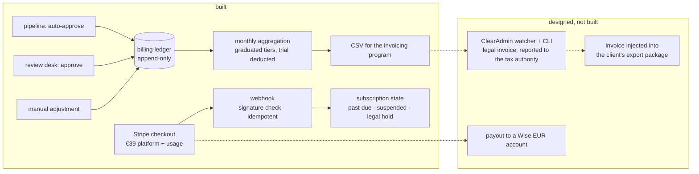

**English** · [Magyar](../hu/04c-billing.md) · [↑ README](../../README.md)

# Billing — the money path

> **In one sentence:** the payment provider collects the money, but what a client owes is decided
> by our own append-only ledger — because a human approval or rejection changes the bill, and
> that decision has to be auditable where it is made.

## The chain

## Responsibilities, split on purpose

| system | its job — and only this |
|---|---|
| **Stripe** | take the payment (card / SEPA), hold the subscription, report payment events |
| **billing ledger** (own database) | record every billable event: auto-approved invoice, invoice approved by a human, manual adjustment, refund |
| **monthly aggregation** | sum the ledger, deduct the trial allowance, apply the graduated tiers, write a CSV |
| **ClearAdmin** (local invoicing program) | issue the legal invoice and report it to the tax authority |
| **Wise** | receive EUR payouts |

**Why not let Stripe invoice?** The issuing company is Hungarian; the invoice must be issued in a
Hungarian-compliant program and reported to the Hungarian tax authority. Alternatives were weighed
and written down: a Portuguese invoicing service could not issue for a Hungarian company; Hungarian
online invoicing services lost to a local program with CSV import — one-off price, full control,
scriptable. The cloud edition of the same program had no API.

**Why a ledger instead of Stripe's usage meter?** The first design sent a usage event to Stripe
from inside the pipeline, with retries. That put a payment provider's availability inside invoice
processing, and made "what does this client owe?" a question only Stripe could answer. The ledger
moved the truth home: one append-only table, one sum at month end.

## The details that make it trustworthy

- **Append-only is enforced by the database,** not by convention: a trigger raises an error on any
  update or delete of a ledger row.
- **Every ledger row has an idempotency key** derived from the pipeline job, so a retried job
  cannot bill twice. Webhooks are idempotent too: each Stripe event ID is recorded once.
- **Signature check on every webhook;** an unsigned or mismatched request gets a 400.
- **Graduated pricing in one place:** €39 platform fee + 1–60 invoices €1.75, 61–120 €1.65,
  121–300 €1.55, 301+ €1.45, defined in one pricing module.
- **Cross-border VAT as code.** Reverse charge applies only if two independent gates pass: the
  client's tax number is verified *and* its EU VAT number is active in VIES. Subscribers are
  re-checked every 30 days, each check logged as evidence.
- **Chargeback = legal hold.** A card dispute sets the account to *past due* and places a legal
  hold that only a human can lift, with an audit entry.
- **Dunning:** past-due accounts are suspended after a 7-day grace; low trial balances trigger a
  warning; an expired trial blocks uploads rather than deleting anything.

## Designed vs built — honestly

| designed | built |
|---|---|
| the CSV lands in a drop folder; a watcher feeds ClearAdmin's CLI; the legal invoice comes back | the CSV writer exists; the watcher and the round trip were never built |
| monthly aggregation on a schedule | the task exists, not scheduled |
| the issued invoice injected into the client's export package | not built |
| Wise payouts | an account, not an integration |
| refunds as ledger rows | the ledger function exists, nothing calls it |
| no usage events to Stripe at all | a later fix for post-trial usage sent them again from a daily sweep — the old path came back through a side door |
| payment-failure push notifications (3 a day, 3 days) | the notification functions exist, not wired to the events |
| spending cap / prepayment for new clients | designed only |

Stripe ran in live mode; **no real payment ever went through** — no customer ever subscribed, so the usage events that a later fix sent from the daily sweep had no subscription to bill. The pilot did not get that far.
