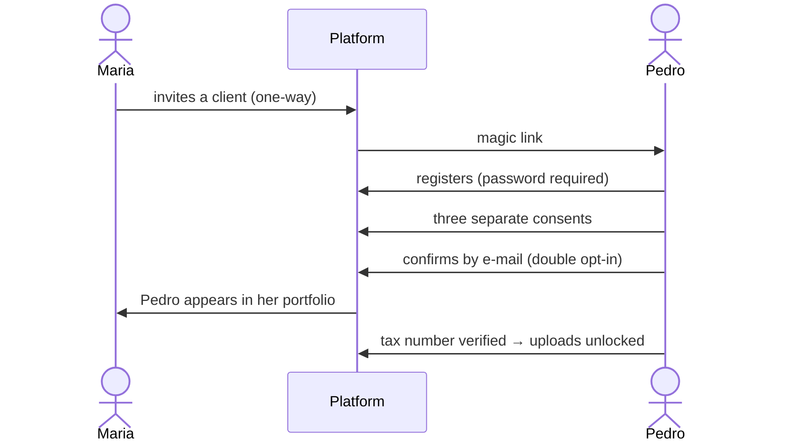

**English** · [Magyar](../hu/05-two-sided-product.md) · [↑ README](../../README.md)

# A two-sided product

> **In one sentence:** the business owner pays and the accountant does not — because the
> accountant is the channel, the targeting and the judge of quality, all at once.

## Two users, deliberately unequal

| | **Maria** — accountant | **Pedro** — business owner |
|---|---|---|
| role in the business | channel + targeting | the payer |
| pays | **no** | **yes** — €39/month + per invoice |
| her / his pain | data entry, chasing missing documents, deadlines | "my accountant keeps asking me for papers", "I don't know where I stand" |
| can we find them? | **yes** — a public register of accounting firms | **hardly** — hundreds of thousands of undifferentiated micro-businesses |
| decides alone? | yes | **no** — if Maria does not accept the output, it is worthless to him |
| what the product promises | "all my clients on one screen; two clicks to nudge the one who is late" | "I drop the PDF, I get a notification, it's done" |

**Why the asymmetry.** The best entry point — foreign invoices, where the PDF is the only source —
is invisible from outside: a bakery's website does not say it buys Italian flour. Maria knows
exactly which of her clients have such invoices. And winning one accountant can bring her whole
client book. So Maria comes first, and Pedro pays.

## The invitation arc

- **One direction only:** the accountant invites; an owner cannot attach himself to an accountant.
- **One account, one role.** An accountant serves many clients through an explicit link table.
- **Consent is a record,** immutable, per purpose — not a checkbox state.
- **Maria never sees billing:** credits, plan, payment status stay Pedro's.

## What each of them sees

- **Maria:** a dashboard in three lanes — *needs attention · waiting for approval · ready* — and per
  client: batches, export packages, VAT summary, supplier profile, trends, alerts, and a message box.
- **Pedro:** upload, and a status in plain words — *processing · accepted · in verification ·
  rejected*. He never sees the words "human in the loop". Push notifications on his phone.

## Messaging — five decisions

1. **Maria writes freely.** An early version offered message templates; they were removed. The
   message goes out under *her* name to *her* client — we are her infrastructure, not her editor.
2. **A technical cap, not a business cap:** 1,000 messages a day per accountant, against a
   hijacked account — not a limit on how she works.
3. **Read receipts** — sent / read.
4. **System pushes only when something blocks you:** payment failed, trial ending, tax number
   failed, past due, account suspended — and Maria's messages. Nothing else interrupts.
5. **Support is brand-invisible:** "the support team" — not a founder's name.

## Two audiences, two front doors — and a third reader

- **For accountants:** the public landing page (Portuguese) speaks to the firm: what it gains, how
  it works, *your data stays safe*, what it costs, and the open objections answered.
- **For owners:** the sales page was reviewed from a small Portuguese business owner's point of
  view before writing a line.
- **For AI assistants:** a third reader was designed in on purpose — an `llms.txt`, an entity
  definition as the hero, an *accuracy and limitations* block — because buyers increasingly ask
  an assistant before they open a website.

## Referral

The owner-side referral programme was built: both sides receive bonus invoices, one level deep,
activated after 30 days, guarded by seven fraud rules. The accountant gets no commission —
**her reward is the service itself, free of charge**, and only the owner ever pays. A commission
would have made the system unethical: the accountant is her client's trusted adviser and the judge
of our output; paid to recommend us, she would have a conflict of interest.

## Designed vs built — honestly

| designed | built |
|---|---|
| the "missing invoices" list on Maria's screen — the core of the later value thesis | not built; the review desk stayed operator-only |
| landing variants per lead source | planned |
| full read receipts in both directions | partial |
