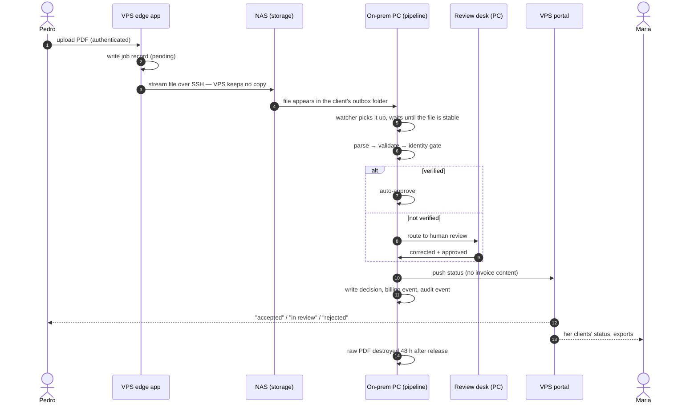

**English** · [Magyar](../hu/06-data-path.md) · [↑ README](../../README.md)

# The data path

> **In one sentence:** raw invoices travel inward to one machine and are processed only there;
> what travels back to the public side is status and masked metadata — extracted values leave
> only in the owner's and the accountant's own export packages.
>
> *The bridge across the three machines is my design; the agents built it to that design.*

## The journey of one invoice

## Step by step — and the decision behind each step

| step | what happens | the decision |
|---|---|---|
| **Upload** | The edge app authenticates the client, writes a job record, and streams the file to the NAS into `client / outbox / job_id`. If the NAS is unreachable, the job fails and the client is told to retry. | The public server **never stores invoice files or values** — it keeps account and job records only. Losing or breaching it exposes no invoices. |
| **Hand-over** | A watcher service on the PC scans every client's outbox, waits until a file stops growing, then takes it. | A folder contract between machines instead of a network API: the PC is never called from outside. |
| **Processing** | Parsing, validation and the identity gate run on the PC only. → [Parsing engine](04-parsing-engine.md), [Trust](05-trust.md) | Raw data is processed in exactly one place. |
| **Review** | Uncertain fields go to an operator desk on the PC. | The human sees the real values only on the same machine that holds them. |
| **Status back** | The PC pushes status to the portal over outbound HTTPS, authenticated with an API key; the decision record keeps field *names* and hashes, values are redacted. | The outward channel carries no content by construction, not by policy. |
| **Delivery** | Daily export packages for the owner and the accountant, built on the PC and stored on the NAS; the portal streams them to the logged-in user. | The only route by which extracted values leave the processing site — to the two people they belong to. |
| **Destruction** | A sweep runs every hour and destroys raw PDFs 48 hours after release. | Keep the result, not the source. |

## What crosses which boundary

Every link is encrypted. The table says where data is *readable* along the way, and whether it stays.

| data | public leg (user → Cloudflare → VPS) | inner leg (VPS → NAS, Tailscale) | processing site (NAS, PC) | stored where |
|---|---|---|---|---|
| uploaded PDF | readable in memory at the Cloudflare edge (TLS termination for the WAF) and on the VPS while it is streamed through | encrypted end to end | processed on the PC | NAS → PC, destroyed 48 h after release |
| extracted values | — | — | PC only | PC processing DB; owner's and accountant's export packages |
| export packages | delivered over TLS to the logged-in owner or accountant | NAS → portal on request | built on the PC | NAS |
| status and masked metadata | portal | pushed by the PC | — | portal DB (projection) |
| account data (users, consents, links) | portal | — | identity map on the PC | portal DB, edge DB |
| EU VAT number (for reverse charge) | sent to the EU VIES service | — | — | check log as evidence |
| payment | handled by Stripe — card data never touches our servers | — | — | Stripe; billing events in our ledger |

**The trade-off, named:** Cloudflare terminates TLS at its edge so that its firewall and bot
protection can inspect requests. That makes Cloudflare a processor of the upload in transit — it
does not store it. The inner leg into the processing site is never decrypted outside our machines. A crash or
a backup at the wrong moment could leave a fragment of an upload on the VPS; nothing writes it there
on purpose.

## The bridge — how it fails safely

Each failure mode of the hand-over has a defined outcome.

| what goes wrong | what happens |
|---|---|
| NAS unreachable during upload | the job is marked failed, the client gets *retry later* (HTTP 503 + Retry-After) |
| file still being written | the watcher waits until the size is stable (30 s); otherwise it skips and the next scan retries |
| the same file seen twice (poll and file event) | marker files (`.done`, `.failed`, `.destroyed`) stop a second parse |
| PC crashes mid-processing | the PDF stays in the outbox; the next scan re-runs it, and the write is an idempotent upsert keyed on the job ID |
| the same invoice uploaded again | a duplicate gate (ATCUD) suppresses it before review; the owner sees *duplicate* |
| portal unreachable | status push is best effort; parsing never depends on it; the decision on the PC stays the source of truth |
| ordering | the decision is persisted **first**, then the status is pushed — a status can never announce a decision that does not exist |
| permanent failure | the PDF stays with a `.failed` marker for audit and manual retry |
| retention | an hourly sweep destroys raw PDFs 48 h after release |

## Three databases, three roles

| database | machine | role |
|---|---|---|
| edge DB (SQLite) | VPS | upload jobs, device tokens, edge authentication |
| portal DB (Postgres) | VPS | what the users see — a **projection**, read-mostly |
| processing DB (Postgres) | PC | **the source of truth**: decisions, billing ledger, review, audit events |

The same route code is mounted by different apps against different databases. That made the
split flexible — and once produced the project's most expensive bug class: a fix applied against
the wrong database returns zero rows and looks like success.

## Designed vs built — honestly

| designed | built |
|---|---|
| encrypted export packages only | the encrypted route ran on schedule; a newer route kept plain files on the NAS (inside the processing site) and streamed them on request |
| 12-month rolling retention with a monthly sweep | the 48-hour raw-PDF destruction was built; the 12-month sweep stayed a design |
| SFTP transfer to the NAS | SSH-exec streaming (the NAS's SFTP service was off) — key-protected, but without SFTP's chroot |

Writing these down was part of the method: a design document that silently disagrees with the
code is worse than none.
