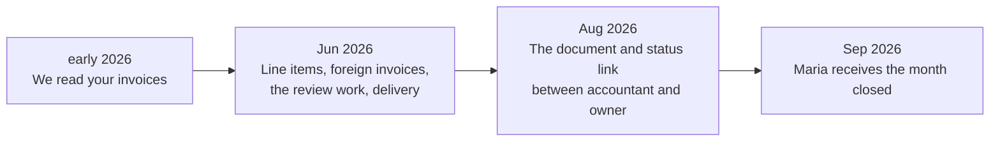

**English** · [Magyar](../hu/06-market-and-pricing.md) · [↑ README](../../README.md)

# Market and pricing

> **In one sentence:** the value thesis moved four times, each time because a measurement or a
> regulation said the previous one was weaker than it looked — and pricing followed the same path.

## How the value thesis moved

| step | what we learned | consequence |
|---|---|---|
| **1 → 2** | Demand is proven — paying incumbents exist and charge for exactly this work. The risk is competition. But the document-AI specialists were moving up-market (one was acquired and went quote-only), leaving the small-accountant corner open. **And** the Portuguese e-invoice system already sends every domestic invoice's header and VAT to the state — the accountant gets it anyway. | Header extraction is not a product in Portugal. The wedge: line items, foreign invoices, the review labour, delivery into the accounting program. |
| **2 → 3** | The state **deliberately** does not collect line items — the tax authority's own e-Fatura leaflet cites personal-data protection [S3]; Portugal's system is consumer-oriented, and an itemised national database would profile the whole population. Hungary chose the opposite. | The line items are a gap by law, not by neglect. The position becomes the link between accountant and owner: documents, status, what is missing. Maturity path: intake tool → intake hub → compliance workflow. |
| **3 → 4** | The president of the accountants' professional body put the pain in numbers: 20–30 % of an accountant's time goes into chasing documents [S1, S2]. The leading accounting program already has a "missing invoices" request — after the month, by e-mail [S4]. | The service: *the month arrives closed* — what is expected has arrived; what arrived is read and checked; what nobody's list sees is flagged; all of it lands in her program. |

## Pricing — from packages to a graduated meter

**The trap.** The first model sold fixed packages (€175 / €495 / €1,500 per month for 100 / 300 /
1,000 invoices). Clients rarely used exactly their allowance; credits piled up, and the client
with 46 unused credits asked "why pay this month?" and cancelled. *The product was working against itself.*

**Four models were compared:** fixed packages · pure usage · hybrid with a chosen band · hybrid
with automatic graduated bands. **Chosen: €39 platform fee + graduated usage** — 1–60 invoices
€1.75, 61–120 €1.65, 121–300 €1.55, 301+ €1.45. The price falls on its own as volume grows; nothing
is pre-paid, nothing is wasted. €49 was the calculated optimum; €39 was shown as the launch price.

**The later benchmark** compared per-document prices: pure extraction tools charge a fraction of
ours. Conclusion: do not compete on extraction price — **sell the human-verified result**, not the
reading. A banded monthly package was the next idea; it stayed open.

## The accountant × owner combination

- **Revenue = accountants × clients per accountant × invoices per client × price.** The lever is
  the first two: win one accountant, invite her whole book in bulk. The invoice count is an
  output, not a lever.
- **Near-zero acquisition cost** through the accountant channel — the route the incumbents also took.
- **The accountant as co-provider:** she stands between the owner and the authorities; we are
  infrastructure for both. She uses it free; only the owner pays.

## Unit economics — what had to be true

- **Exception-based review, not full review:** the model auto-accepts what it can verify; people
  handle the rest. Below ~200 invoices a month, hybrid human-plus-machine wins; above ~500,
  automation does. Our small clients (12–70 a month) sit in the hybrid zone.
- **North-star metric from day one: human minutes per invoice over time.** If it falls with
  volume, the model scales; if it stays flat, the margin is labour margin.
- **Hardware as a fixed cost:** no cloud means the processing machine amortises with volume. A
  GPU machine for local vision-language models was planned — financed from revenue, not before it.
- **A second market as an option:** the US has no e-invoice system, so extraction keeps its full
  value there — but the no-cloud differentiator does not travel. "Mutate later", not a pivot.

## The regulatory window

Small businesses may issue plain PDF invoices until the end of 2026; structured e-invoices with a
qualified signature are due from 2027 (Decree-Law 13-A/2025) — a deadline already postponed before. Foreign and consumer
invoices stay outside either way. The window was real, but closing.

## Go-to-market as a measurement machine

- A **channel map** — cold e-mail, follow-up, forums, accounting-software partners, the
  professional body, content, paid — opened in **waves with exit gates**, not dates: stay on one
  channel until it produces a payer or its reply rate is provably below 1 % after 150 contacts.
- **List building with a law of evidence:** a guessed domain cannot confirm itself — an independent
  signal is required (the company number on the page, the professional-register entry).
- **Census, not sampling;** a confidence interval on every rate; **decision thresholds written down
  before looking at the data;** a bounce gate before every send.
- Outcome: ~240 e-mails, no human reply — below the size at which the channel could fail cleanly.
  → [Post-mortem](09-post-mortem.md)

## The legal layer

Drafted for the pilot, the client-facing ones also in Portuguese: data processing agreement with an accountant
addendum, terms, privacy and cookie policies, acceptable use, consent management, account
deletion protocol, subprocessor list, retention summary, records of processing, two data
protection impact assessments (profiling; deletion and transfer), legitimate-interest assessments
(profiling; cold outreach), incident response plan, NDAs.

## Ideas worth keeping

1. **The missing-invoice list as the core,** predicted from the client's own history — it moves
   the accountant's surprise from after the month to during it.
2. **"The month arrives closed"** — a service definition, not a software feature.
3. **The accountant as the targeting mechanism** for an entry point that is invisible from outside.
4. **Graduated metering** instead of packages — no credit trap.
5. **A law of evidence for sales lists,** and decision thresholds fixed before the data.
