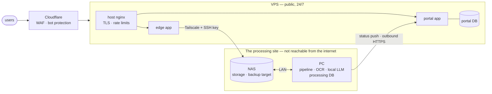

**English** · [Magyar](../hu/08-infrastructure.md) · [↑ README](../../README.md)

# Infrastructure and operations

> **In one sentence:** the no-cloud promise is enforced by topology — the machine that sees raw
> invoices is on-prem and cannot be reached from the internet; the public face is a separate
> server that only relays.
>
> *The topology — which machine does what, and how they hand data to each other — is my design.*

## Three nodes, three jobs

| node | runs | why there |
|---|---|---|
| **VPS** | host nginx (TLS, rate limits), the edge app, the portal app, the portal database, the web front end | It must be reachable all the time — and it must be expendable. |
| **NAS** | inbound files, outbound results, backups | Storage that both sides can reach, without either side reaching the other directly. |
| **PC** | the whole processing stack: parser, OCR, local LLM, task queues, processing database, review desk | Raw data stays on hardware I own. |

## The links between them

| link | role | decision |
|---|---|---|
| **Cloudflare → VPS** | the front door: TLS, web application firewall, bot protection | Absorb abuse before it reaches the server. |
| **Tailscale VPS ↔ NAS** | the inner corridor: the VPS drops files on the NAS over SSH | A separate WireGuard layer was removed — Tailscale already *is* WireGuard; two of them doubled the configuration for zero gain. Fallback if Tailscale fails: SSH pull. |
| **LAN NAS ↔ PC** | inside the processing site | No overlay network between two machines on the same switch. |
| **PC → portal** | status back: outbound HTTPS through Cloudflare, authenticated with an API key | The PC opens the connection, so it needs no inbound port — consistent with "nothing calls the PC". Best effort: parsing never waits for it. |

## Deployment

- **Two apps on the VPS, on purpose:** a thin *edge* (uploads, push notifications, mail webhooks)
  and the *portal* (everything the users see). A compromised edge cannot reach client-data logic,
  and each app ships only its own dependencies.
- **Host nginx, not a container,** with the certificate renewed by the host.
- **Deploy script:** migrate the database → rebuild and recreate the containers → health check.
  Code reached the VPS by rsync, not by git — a known compromise, listed as debt.
- **The drift list as a method.** When the live deployment had drifted from its documents, I audited the
  server over SSH and kept a numbered list (24 items) of every difference, each with a status: closed,
  partial, deferred. Seven deployment phases closed most of it in a single day.

## Backup and disaster recovery

| tier | what | status |
|---|---|---|
| 0 | VPS provider snapshots (4 daily) | built |
| 1 | NAS: database dumps and volumes from PC and VPS, **age-encrypted**, 14 daily + 4 weekly + 12 monthly | built |
| 2 | second NAS off-site | planned |
| — | **off-site git:** a verified `git bundle` of the whole history on an air-gapped external drive, after every working day; no git remote at all | built |

The private decryption key lives only in a password manager and on paper. Database volumes on the
VPS are additionally LUKS-encrypted.

**The 17-day silent failure.** After a NAS update the backup user lost its shell; SSH keys were
still accepted, so the session opened and immediately closed. For 17 days the backup job sent
412 failure pings to the monitoring service — which had no alert channel configured. Nothing
rang. Lesson, now a rule: *a failure signal is only real if someone receives it* — every check
must name its channel, and the channel is tested.

## Monitoring

- Prometheus, Alertmanager, Grafana and node-exporter, with alert rules for backups (stale,
  failed, size anomaly, missing heartbeat, off-site lag, restore drill), system resources, QA
  pass-rate, extraction accuracy and build trends.
- A **dead-man's switch** off-site (heartbeat every 5 minutes, 20-minute grace): silence
  itself raises the alarm.

## Designed vs built — honestly

| designed | built |
|---|---|
| monitoring always on | the observability stack sat behind a Compose profile and did not start by default |
| monthly automatic restore drill | the alert rule exists, the drill does not |
| second off-site NAS | planned |
| git-based deploy to the VPS | rsync, with a template-and-script baseline in git |
