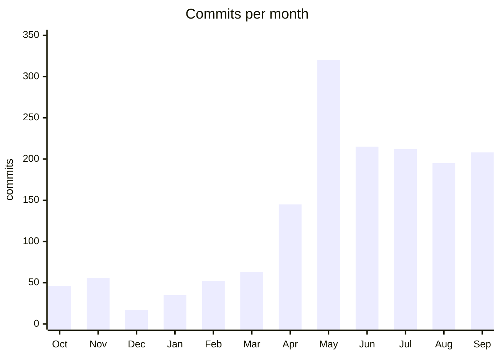

**English** · [Magyar](../hu/b-metrics.md) · [↑ README](../../README.md)

# Metrics

> Every number here has a date and a source. Where a number measures something narrower than it
> sounds, the table says so.

## The size of the work

| metric | value | measured |
|---|---|---|
| commits | 1,564 | git history, Oct 2025 → Sep 2026 |
| Python | ~249,000 lines in 1,149 files | tracked files, 2026-10-12 |
| of which tests | ~75,000 lines in 365 files; 3,690 test functions | same |
| frontend | ~28,000 lines in 177 files | same, deprecated app excluded |
| Docker services | 18 | `docker-compose.yml` |
| extraction schemas | 2 country masters + 1 generic master + 19 vendor deltas (YAML) | `schemas/` |
| architecture documents | 70 | `docs/architecture/` |
| session logs | 182 | Feb → Sep 2026 |
| decision & lesson notes | ~300 | memory system |

Where the effort went — commits touching each area (one commit can touch several):
platform ~580 · parsing engine and lab ~270 · tests and QA ~270 · user interfaces ~230 ·
market, pricing, legal, landing ~70 (most of that work lives in design notes, not commits).

## The engine

| metric | value | date | what it really measures |
|---|---|---|---|
| golden set | 203 annotated invoices | Aug 2026 | public sample invoices, not client data |
| line items fully reconciled | **19 %** (59 measurable) | May 2026 | the **lab extractor** (a table-recognition model), not the production ladder |
| line items fully reconciled | **10.3 %** — 10 of 97: the invoices with a ground truth among the 101 measured before the run was stopped (of 203) | Aug 2026 | same lab extractor, larger and harder set |
| invoices yielding no line items | 57 % of the clean subset (134 invoices — see [Glossary](c-glossary.md)) | Aug 2026 | same |
| precision of the confident band | 0.854 | May 2026 | lab gate on the measurable set |
| invoices without a QR code | 21 % of the golden set | Aug 2026 | share with no independent oracle |
| median processing time | 132 s per document | Aug 2026 | lab run, including the table model |
| refactor safety | 10 / 10 reference invoices bit-exact before and after | May 2026 | Portuguese pipeline baseline |
| automatic approval in production | **off** — every invoice to review | pilot configuration | a deliberate setting, not a measurement |

## The platform

| metric | value | date |
|---|---|---|
| route files still accessing the database directly | 55 of 70 | 2026-10-12 (regex count) |
| scope-resolver switch-over | 14 characterisation + 3 differential tests, 0 regressions | Jun 2026 |
| deployment drift list | 24 items, most closed in one day across 7 phases | May 2026 |

## Infrastructure

| metric | value | date |
|---|---|---|
| open TCP ports on the processing site, scanned from the VPS (top-100 TCP, SYN scan, 3.5 s delay) | 0 | 2026-09-11 |
| port-scan trap reaction time | < 20 s | Sep 2026 |
| silent backup failure, before it was noticed | 17 days, 412 unrouted failure pings | Apr–May 2026 |
| off-site git snapshot | full history, verified bundle, after each working day | from Jul 2026 |

## The market

| metric | value | date |
|---|---|---|
| qualified accounting-firm addresses | 149 | Aug 2026 |
| first contacts sent / delivered | 127 / 120 | Aug 2026 |
| bounce rate | 5.5 % (benchmark: ≤ 2 %) | Aug 2026 |
| e-mails in total, incl. follow-ups | ~240 | Aug 2026 |
| human replies | 0 | Aug 2026 |
| probability of 0 replies at a true 1 % rate and 120 delivered | ~30 % | — too small a sample to judge |
| real payments | 0 — Stripe in live mode, no customer ever reached billing | Sep 2026 |

## The measurement lessons

- **Check what the number measures.** The line-item rates measured a candidate extractor, not the
  production path — I found this late.
- **A zero needs its own proof.** Two clean-looking zeros in the port scan were artefacts of the
  method; the recipe was fixed before the result was trusted.
- **A signal no one receives is not a signal.** 412 failure pings, no alert channel.
- **Size the experiment to the decision.** 120 deliveries cannot distinguish a 1 % reply rate from 0 %.

## Sources

| | claim | source |
|---|---|---|
| S1 | "20 to 30 % of the professional's time goes into chasing documents" | Interview with the president (*bastonária*) of the Portuguese Order of Certified Accountants (OCC), *Revista Contabilista* 307, Dec 2025 — [occ.pt](https://www.occ.pt/pt-pt/noticias/entrevista-paula-franco-bastonaria-da-occ) |
| S2 | the friction of chasing clients for documents | ECO, 10 Dec 2025 — [eco.sapo.pt](https://eco.sapo.pt/2025/12/10/occ-quer-alteracao-legislativa-para-criar-o-contabilista-3-0/) |
| S3 | e-Fatura data never includes the description of goods or services, for personal-data protection | Portal das Finanças, e-Fatura information leaflet — [portaldasfinancas.gov.pt](https://info.portaldasfinancas.gov.pt/pt/apoio_contribuinte/Folhetos_informativos/Documents/efatura_portal.pdf) |
| S4 | "request missing documents by e-mail" in the leading accounting program | TOConline manual — [manual.toconline.pt](https://manual.toconline.pt/support/solutions/articles/3000110064-pedir-documentos-em-falta-por-e-mail); plans €0 / €9 / €14.58 per month, toconline.pt pricing page |

All accessed September 2026.
