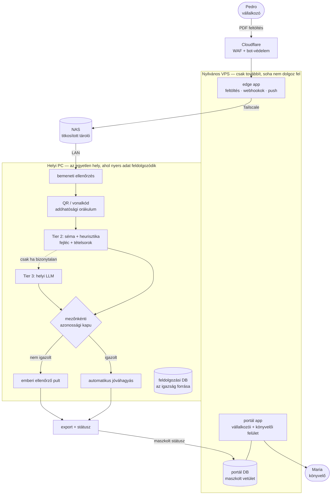

[English](../en/00-at-a-glance.md) · **Magyar** · [↑ README](../../README.hu.md)

# Áttekintés

## A rendszer egy képen

## Tizennégy döntés, amely meghatározza

| # | döntés | miért | az ára |
|---|---|---|---|
| 1 | **Nincs felhő.** A nyers számlák kizárólag egy helyi PC-n dolgozódnak fel; a nyilvános VPS továbbít és státuszt mutat. | Az adat-szuverenitás maga a termék ígérete a kisvállalkozóknak és a könyvelőknek. | Három gép, titkosított kapcsolatok, helyi OCR/LLM, egyetlen helyi feldolgozó gép — és a nyilvános szakaszon a Cloudflare útközben olvassa a feltöltést (TLS-bontás a tűzfalához). |
| 2 | **Az adóhatósági QR-kód az orákulum.** A portugál számlán aláírt QR hordozza a fejléc-értékeket; a vizuális olvasat keresztellenőrzés, nem forrás. | Egy gépileg ellenőrizhető igazság többet ér bármely megbízhatósági pontszámnál, amit egy modell önmagáról mond. | A QR nélküli (külföldi, régebbi) számlának nincs orákuluma — pont azoknak, amelyeknél a legnagyobb a segítség-igény. |
| 3 | **Rétegzett kiolvasás:** QR → séma/heurisztika → helyi LLM csak végső esetben. | Előbb az olcsó és determinisztikus; a lassú modell csak ott, ahol kell. | Három kódút, amelyeket konzisztensen kell tartani. |
| 4 | **A séma adat.** Országonként egy master YAML + számlázó szoftverenként delta YAML, a szoftver tanúsítvány-száma alapján automatikusan kiválasztva. | Egy új beszállítói elrendezés egy YAML-fájl, nem kódmódosítás. | A lefedettség szoftverenként, egyesével nő. |
| 5 | **Precizitás először: a rendszer soha nem találgat.** Egy rossz sor rosszabb, mint egy hiányzó. | A hiányzó értéket az ellenőrzés elkapja; a magabiztosan rosszat nem — az eljut a könyvelőhöz. | Alacsonyabb automatizálási arány — szándékosan. |
| 6 | **Mezőnkénti azonossági kapu**, kezdetben szigorú, lazítás csak mért tapasztalat alapján. | A bizalom a vagyon; a kapu az a pont, ahol a bizalom érvényesül. | A pilotra az automatikus jóváhagyás kódban ki volt kapcsolva — minden számla ellenőrzésre ment. |
| 7 | **Két alkalmazás a nyilvános szerveren:** egy vékony edge (feltöltés, webhookok, push) és a portál. | Egy feltört edge ne érje el az ügyféladat-logikát. | Két telepítendő egység, két függőségkészlet. |
| 8 | **Három adatbázis = három csomópont, nem három másolat.** Az igazság forrása fizikailag a PC-n van; a nyilvános oldal maszkolt vetületet tart. | A nyilvános szerver elveszhet anélkül, hogy az igazság elveszne — vagy kiszivárogna. | Egy szinkron-híd, amit kifejezetten meg kellett tervezni. |
| 9 | **Rétegzett kapcsolatok:** elöl Cloudflare a VPS előtt, Tailscale VPS↔NAS, LAN NAS↔PC. Egy külön WireGuard-réteget redundánsként kivezettem. | Minden ugrásnak egy feladata van; a feldolgozó telephelyen az internetről semmi nem érhető el — egy külső szkennelés (2026. szept., a VPS-ről) nulla nyitott TCP-portot talált; a VPS-en csak a webes portok és az SSH látszottak. | Bármely réteg kiesése megállítja a folyamot — dokumentált vészút: SSH-lehúzás. |
| 10 | **A vállalkozó fizet, a könyvelő nem.** A könyvelő a csatorna: egy könyvelő megnyerése a teljes ügyfélkörét hozza. | Bevétel = könyvelők × ügyfél/könyvelő × számla × ár. Jutalék sincs: a könyvelő az ügyfele bizalmi tanácsadója — ha fizetnénk neki az ajánlásért, összeférhetetlen lenne. | Két felhasználói csoport, két felület, meghívási folyamat a kettő között. |
| 11 | **Árazás: havi €39 + sávos, számlánkénti díj** fix csomagok helyett. | A fix csomag kredit-felhalmozási csapdát szült: a fel nem használt kredit miatt mondták le az ügyfelek. | Kevésbé kiszámítható bevétel. |
| 12 | **PII-kapu — a rendszert építő AI felé is.** Ügyfélszámla tartalma soha nem kerül LLM elé, a fejlesztő ügynökök elé sem — és soha nem is került: élő ügyféladat nem volt, a fejlesztési korpusz önkéntesen megosztott, nyilvános minta volt. 2026 júliusától egy eszköz-kapu kényszerítette ki. | A felhő nélküli ígéretnek az építőre is érvényesnek kell lennie. | Hibakeresés és séma-tanítás csak maszkolt adaton. |
| 13 | **A pénz útja felelősség szerint szétválasztva:** a Stripe csak beszedi a fizetést; minden számlázható esemény egy csak-hozzáírható főkönyvbe kerül a saját adatbázisunkban; hó végén a főkönyvből CSV készül egy helyi számlázó programnak (ClearAdmin), amely kiállítja a hivatalos számlát; a kifizetések Wise EUR-számlára mennek. Fordított adózás csak VIES-ben igazolt EU-adószámra. *A CSV-ig megépült; a számlázási visszaút terv maradt.* | A főkönyv az auditálható igazság — egy emberi jóváhagyás vagy elutasítás megváltoztatja, mennyivel tartozik az ügyfél, és ez nem élhet egy fizetési szolgáltató belsejében. | Négy rendszert kell egyeztetni, és egy határon átnyúló ÁFA-szabályt kódban kikényszeríteni. |
| 14 | **A pipeline-híd mappa-szerződés, nem API.** A nyilvános szerver a NAS-ra teszi a fájlt; a PC-n egy figyelő felveszi; a státusz push-ként megy vissza. A PC-t kívülről soha senki nem hívja. | A feldolgozó gépnek nem kell nyitott port és nyilvános végpont; minden hibamódnak meghatározott kimenete van. | Lekérdezési késleltetés és jelzőfájl-könyvelés a kérés–válasz hívás helyett. |

Minden sor teljes döntés-rekordként is olvasható: [Döntés-rekordok](adr.md).

## Négy történet, amire érdemes rákérdezni

- **A bitre azonos lépcső** — hogyan lett kisebb egy 1 482 soros feladat egyetlen kimenet megváltoztatása nélkül. → [Platform](04b-platform.md#megmérve-aztán-lépcsőnként-javítva)
- **A 17 napos néma mentési hiba** — 412 hibajelzés, amit senki nem kapott meg. → [Infrastruktúra](04-infrastructure.md#mentés-és-katasztrófa-helyreállítás)
- **A hamis nulla** — egy port-szkennelés, amely rossz okból jelzett „tisztát". → [Infrastruktúra](04-infrastructure.md#izoláció--kimondva-aztán-megmérve)
- **A szám, amely mást mért** — a tételsor-arányok a labor-kiolvasón születtek, nem a produkción. → [Mérőszámok](08-metrics.md#a-mérési-tanulságok)

## Hová ment a munka

A területenkénti commit-szám durva mérték (egy commit több területet is érinthet):

| terület | commit |
|---|---|
| Platform: API, szolgáltatások, adatbázisok, háttér-feladatok, nyilvános szerver | ~580 |
| Kiolvasó motor + mérő-labor | ~270 |
| Tesztek és QA | ~270 |
| Felületek: vállalkozó, könyvelő, operátor, mobil | ~230 |
| Piac, árazás, jog, landing oldalak | ~70 *(e munka zöme tervezési jegyzetekben él, nem commitokban)* |
