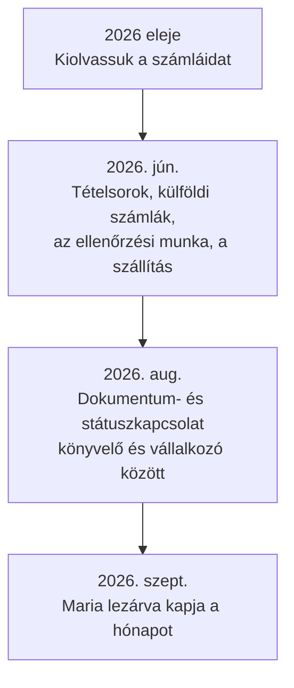

[English](../en/01-problem-and-market.md) · **Magyar** · [↑ README](../../README.hu.md)

# A probléma és a piac

> **Egy mondatban:** a portugál számla fejléce már eljut az államhoz, így az érték abban volt, ami
> nem — a tételsorokban és a még be nem gyűjtött dokumentumokban —, és a tézis négyszer mozdult,
> ahogy a mérések és a szabályozás élesítették a képet.

## A probléma három tényben

1. **A könyvelők idejük 20–30%-át azzal töltik, hogy dokumentumokat hajtanak be** az ügyfeleiktől —
   szakmai kamarájuk elnökének szavaival [S1, S2].
2. **Minden belföldi számla fejléce már megvan az államnál.** Az e-Fatura rendszeren át a kibocsátó,
   a vevő, a dátum és az áfa automatikusan bejelentődik; a könyvelő le tudja tölteni. **A tételsorok
   szándékosan kimaradnak**, személyesadat-védelmi okból [S3].
3. **A hónap egy részére még mindig a PDF az egyetlen forrás:** a kisvállalkozások 2026 végéig
   kiállíthatnak egyszerű PDF-számlát, a külföldi számlák pedig soha nem jelennek meg az e-Faturában.

Az érték tehát nem a fejléc kiolvasásában van, hanem abban, amit senki más nem gyűjt össze: a
tételsorokban, a külföldi számlákban és azokban a dokumentumokban, amelyekre a könyvelő még vár.
Az S1–S4 források a [Mérőszámok](b-metrics.md#források) fejezetben vannak.

## Hogyan mozdult az érték-tézis

| lépés | mit tanultunk | következmény |
|---|---|---|
| **1 → 2** | A kereslet bizonyított — vannak fizető inkumbensek, és pont ezért a munkáért kérnek pénzt. A kockázat a verseny. De a dokumentum-AI specialisták a nagyvállalati piac felé mentek (egyiküket felvásárolták, és csak egyedi ajánlatra árazott), a kis könyvelők sarka szabadon maradt. **És** a portugál e-számla rendszer minden belföldi számla fejlécét és ÁFA-ját már eljuttatja az államhoz — a könyvelő enélkül is megkapja. | A fejléc-kiolvasás Portugáliában nem termék. A rés: tételsorok, külföldi számlák, az ellenőrzési munka, a szállítás a könyvelőprogramba. |
| **2 → 3** | Az állam **szándékosan** nem gyűjti a tételsorokat — az adóhatóság saját e-Fatura tájékoztatója a személyes adatok védelmére hivatkozik [S3]; a portugál rendszer fogyasztó-központú, és egy tételszintű országos adatbázis a teljes lakosságot profilozná. Magyarország az ellenkezőjét választotta. | A tételsor törvényi rés, nem hanyagság. A pozíció a könyvelő és a vállalkozó közti kapcsolat lesz: dokumentumok, státusz, ami hiányzik. Érési út: beérkeztető eszköz → beérkeztető központ → megfelelőségi munkafolyamat. |
| **3 → 4** | A szakmai testület saját száma — a fenti 1. tény — kézzelfoghatóvá tette a fájdalmat. A vezető könyvelőprogramban már van „hiányzó dokumentumok" bekérése — a hónap után, e-mailben [S4]. | A szolgáltatás: *a hónap lezárva érkezik* — ami várható, beérkezett; ami beérkezett, kiolvasva és ellenőrizve; amit senki listája nem lát, jelezve; és mindez a könyvelő programjában. |

## A szabályozási ablak

A kisvállalkozók 2026 végéig még sima PDF-számlát állíthatnak ki; 2027-től strukturált e-számla
és minősített aláírás jön (13-A/2025. törvényerejű rendelet) — egy határidő, amit korábban már elhalasztottak. A külföldi és a
fogyasztói számlák mindkét esetben kívül maradnak. Az ablak valós volt, de záródott.

Ki használja a terméket, és miért csak az egyik fél fizet → [Termék és felhasználók](02-product-and-users.md).
