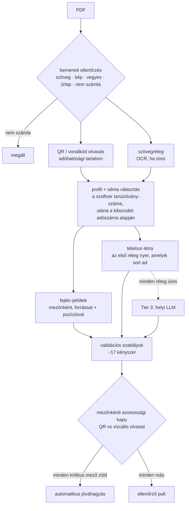

[English](../en/02-parsing-engine.md) · **Magyar** · [↑ README](../../README.hu.md)

# A kiolvasó motor

> **Egy mondatban:** előbb az olcsó, determinisztikus olvasók, helyi modell csak végső esetben —
> és minden értéket egy független forráshoz mérünk, mielőtt bárki megbízhatna benne.

## A pipeline

## Szakaszról szakaszra

| szakasz | mit csinál | miért így |
|---|---|---|
| **Bemeneti ellenőrzés** | Besorolja a fájlt (szöveg / kép / vegyes / űrlap), és csak magabiztos „nem számla" esetén áll meg. | A szemetet az OCR-költség előtt kiszűrni; minden más információ, nem kapu. |
| **QR-olvasás (Tier 1)** | 300 DPI-n olvassa a portugál adóhatósági QR-t, beágyazott képekre is. A tartalom: kibocsátó és vevő adószáma, bizonylattípus, dátum, sorszám, ATCUD, ÁFA-sávok, végösszegek. | A QR aláírt és az államnak bejelentett — ez az **orákulum**, az egyetlen forrás, amit a motornak nem kell hitre elfogadnia. |
| **Szöveg + OCR** | Előbb a szövegréteg; Tesseract csak akkor, ha a szövegréteg (szinte) üres. | A számlák többsége digitálisan születik; az OCR a drága kivétel. |
| **Séma-választás** | A QR hordozza a számlázó szoftver tanúsítvány-számát; ez egy *delta* sémát választ az ország *master* sémája fölé. Tanúsítvány nélkül a kibocsátó adószáma irányít. | Egy számlázóprogram = egy elrendezés-család. Új beszállító = egy YAML-fájl. |
| **Fejléc-jelöltek** | Minden mező jelölteket gyűjt forrással (QR, séma, heurisztika) és oldal-pozícióval. | Az alternatívák megmaradnak, amíg a bizonyíték dönt — soha nem választunk korán. |
| **Tételsor-létra (Tier 2)** | Legfeljebb hét réteg, sorrendben: sémában megadott doboz → vonalas táblázat → szóközös táblázat → Tabula (az eredeti négy) → oszlop-geometria → grafikus táblázat → tábla-transzformer modell (kapcsoló mögött) — ez a három később került be; a függvény docstringje még az eredeti négyet írja le. Az első réteg nyer, amelyik sort ad; a folytatósorok egyesülnek, a részösszeg-sorok kiesnek. | Előbb a legolcsóbb megbízható módszer — és minden sorról tudható, *melyik* módszer adta. |
| **Tier 3 (helyi LLM)** | Csak ha a létra minden rétege üres: kis helyi modell (Qwen2.5 3B, Ollama) JSON-sémával, 120 mp időkorláttal, három egymást követő hiba után megszakítóval. | Nincs felhő. A modell a végső eszköz, nem a motor. |
| **Validációs szabályok** | Tizennégy regisztrált kényszer: ÁFA-háromszög (nettó + adó = bruttó), adószám-ellenőrzőösszeg és -irány, dátum-tartomány, ATCUD- és QR-konzisztencia, tételsor-matematika vízszintesen és függőlegesen, ÁFA-kulcs érvényessége, oldal-limit. Kimenet: jóváhagyás, egy mező ellenőrzése, teljes ellenőrzés, elutasítás. | Üzleti szabályok kódként, mindegyik néven nevezve és tesztelhetően. |

## Az azonossági kapu — ahol a bizalomról döntünk

Minden mezőnek van egy bejegyzése a **mező-katalógusban**: kanonikus név, QR-slot, vizuális
slotok, típus, kritikus-e, és hogyan ellenőrizhető:

| osztály | mi igazolja | példa |
|---|---|---|
| **a** | független forrás (QR, ellenőrzőösszeg) | adószámok, végösszegek, dátum, ATCUD |
| **b** | aritmetika a mezők között | nettó + ÁFA = bruttó |
| **c** | semmi — csak olvasott | beszállító neve, szabad szöveg |

A motor mezőnként összeveti a QR-olvasatot a vizuálissal (összegeknél 2 cent tűréssel), és sávba sorolja:

- 🟢 **zöld** — a két független forrás egyezik;
- 🟠 **borostyán** — csak egy forrás van, vagy enyhe eltérés;
- 🔴 **piros** — kemény szabály sérült (vétó).

A dokumentum megbízhatósága a **kritikus, ellenőrizhető mezői közül a legkisebb** — egyetlen
kétes végösszeg elég a megállításhoz. Ha nincs ellenőrizhető kritikus mező, a megbízhatóság nulla.

**A pilotra az automatikus jóváhagyás kódban ki volt kapcsolva.** Minden számla az ellenőrző
pultra ment, és a kapu azt döntötte el, *mit kell az operátornak megnéznie*, nem azt, *hogy
megnézi-e valaki*. A terv: mezőnként lazítani, kizárólag mért bizonyíték alapján — előbb
szigorú, aztán csak ott lazítunk, ahol a mérés megengedi.

## Az ellenőrző pult

A pult kockázati sorrendben, mezőnként mutatja a teendőt:

- **a zöld mezőket átugorja** — a kurzor meg sem áll rajtuk;
- adószámnál és végösszegnél a beviteli cella **üresen indul**, így az operátor azt gépeli be,
  amit lát, nem a gép javaslatát hagyja jóvá (horgonyhatás elleni védelem);
- mentéskor **ugyanazok a validátorok ítélik meg az embert, mint a gépet** — a rossz félhez
  beírt adószámot a rendszer elutasítja, hacsak nincs kifejezett felülbírálás.

A fő mérőszám nem az automatikus jóváhagyási arány volt, hanem az **operátor-idő számlánként**:
amíg a bizalom épül, minden ellenőrzésre megy, tehát a kérdés az, milyen gyorsan.

## A mérő-labor

- **Arany-halmaz:** 203 annotált számla (nyilvánosan elérhető mintaszámlák, nem ügyféladat).
- **QR-horgonyzott tételsor-mérőszám:** kiadják-e a kiolvasott sorok a számla nettó végösszegét?
  Minden számla *egyező*, *eltérő összegű* vagy *üres* eredménnyel zárul.
- **Nyolcfázisú javító ciklus** — tájékozódás, mérés, triázs, diagnózis, kísérlet, javítás,
  ellenőrzés, rögzítés —, ahol minden változtatás a mért hatása alapján marad vagy megy.
- ⚠️ **Mit mérnek a számok.** A repóban szereplő tételsor-arányokat (19 % májusban, 10,3 %
  augusztusban) a **labor-kiolvasón** mértük — egy táblázat-felismerő modellen, amelyet a létra
  következő rétegének jelöltjeként értékeltünk —, nem a fenti produkciós létrán. Ezt az
  eltérést én magam vettem észre, későn; a mérési tanulságok között szerepel.

## Terv vs megépült — őszintén

| tervezve | megépült |
|---|---|
| elrendezés-ujjlenyomat mint tartalék, ha nincs tanúsítvány-szám | a komponens és a gyorsítótár-táblája létezik; a produkció soha nem hívja |
| a táblázat-felismerő modell mint létra-réteg | csak a laborban |
| automatikus jóváhagyás egy megbízhatósági küszöb felett | a pilotra kikapcsolva; kapcsoló mögött létezett egy opcionális „biztonságos jóváhagyás" út |
| az LLM-megszakító mint átmeneti kikapcsolás | a folyamat élettartamára reteszel |

## Tovább

Eredeti tervdokumentumok (magyarul): kiolvasási rétegek, séma-stratégia, tételsor-kiolvasás,
az azonosság → ellenőrzés szerződés, az ellenőrző pult keretrendszere.
