[English](../en/03-client-interface.md) · **Magyar** · [↑ README](../../README.hu.md)

# Az ügyfél-felület, képernyőről képernyőre

> **Egy mondatban:** a motor mögött egy teljes, működő termék állt kétféle felhasználónak — a
> vállalkozónak, aki feltölt és fizet, és a könyvelőnek, aki egy képernyőn látja az összes
> ügyfelét —, úgy tervezve, hogy egyiküknek se kelljen az ügyfélszolgálatot hívnia.

Az oldal a projekt lezárása után megszűnt. A képek az élő rendszerről készültek 2026. október 13-án,
minta-fiókokkal; minden cégnév, adószám, e-mail-cím és fájlnév szintetikusra van cserélve.

## Az ötlet egy képben

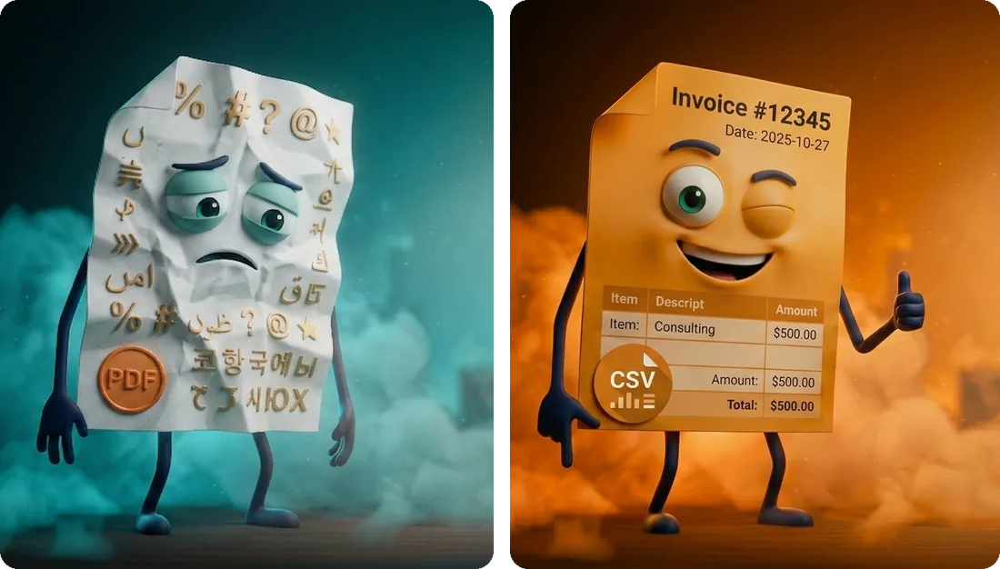

*Phil* egy számla. Balra az, ami a vállalkozónak ma van: egy PDF, amivel senki nem tud mit kezdeni.
Jobbra az, amit a könyvelő megkap: strukturált adat. A termék teljes ígérete belefér ebbe az
előtte–utána képbe, ezért ezzel nyit a landing oldal, és Phil csak ott tér vissza, ahol a folyamat
befejeződik. Az illusztrációs stílus — lapos, rögzített paletta a design-tokenekből, Phil mindig
előtérben és keretben — rövid stílusútmutatóban le van írva, hogy az új képek egységesek maradjanak.
A koncepció és a stílusszabályok az enyémek; a képek Nano Bananával és Claude Designnal készültek.

## Két felhasználó, két út

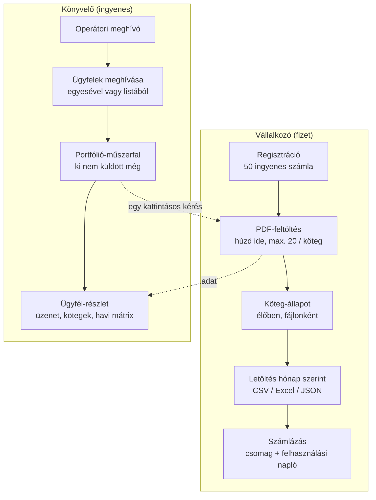

A két oldal egy ponton találkozik: a könyvelő egy kattintással elkéri a hónap számláit, a vállalkozó
feltöltése pedig ellenőrizve érkezik meg az ő ügyfél-nézetébe. A kettő közötti ellenőrző pult belső,
operátori eszköz — leírása a [Bizalom](05-trust.md#az-ellenőrző-pult) fejezetben.

## A nyilvános oldal

| | |
|---|---|
|  |  |
| **A vállalkozói landing.** Egy kérdés („Még kézzel gépeli a számlákat?"), egy ajánlat (50 ingyenes számla), három ígéret: minden számlát ember ellenőriz, az eredmény másnap reggelre kész, nincs nyilvános felhő. | **Külön landing a könyvelőknek**, csak meghívó-linkkel érhető el (nem indexelt). Az ő ügyfeleiről beszél, nem az ő számláiról. |
| 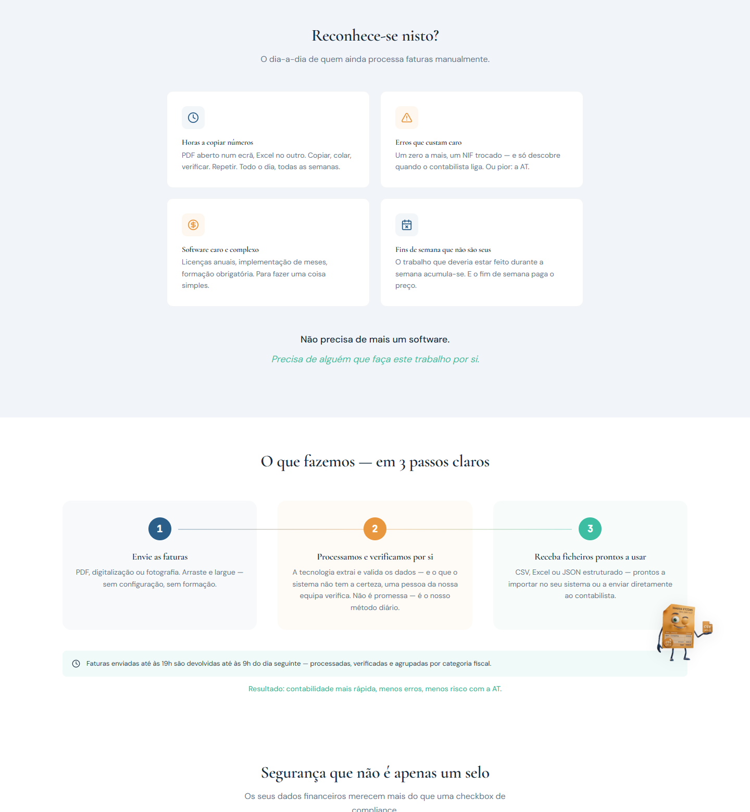 | 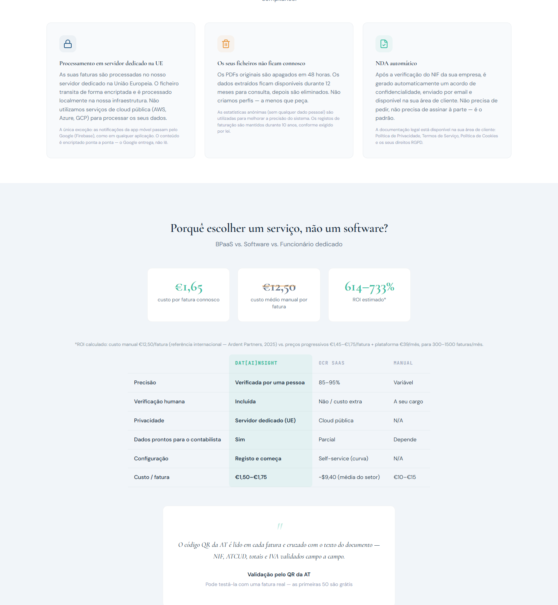 |
| **„Ráismer?"** — a vállalkozó napja négy kártyán, aztán a három lépés. A válasz szolgáltatásként van keretezve, nem újabb szoftverként. | **Biztonság, ami több egy matricánál**, és őszinte összevetés az OCR-szoftverrel és a kézi munkával. |

## A vállalkozó oldala

| | |
|---|---|
| 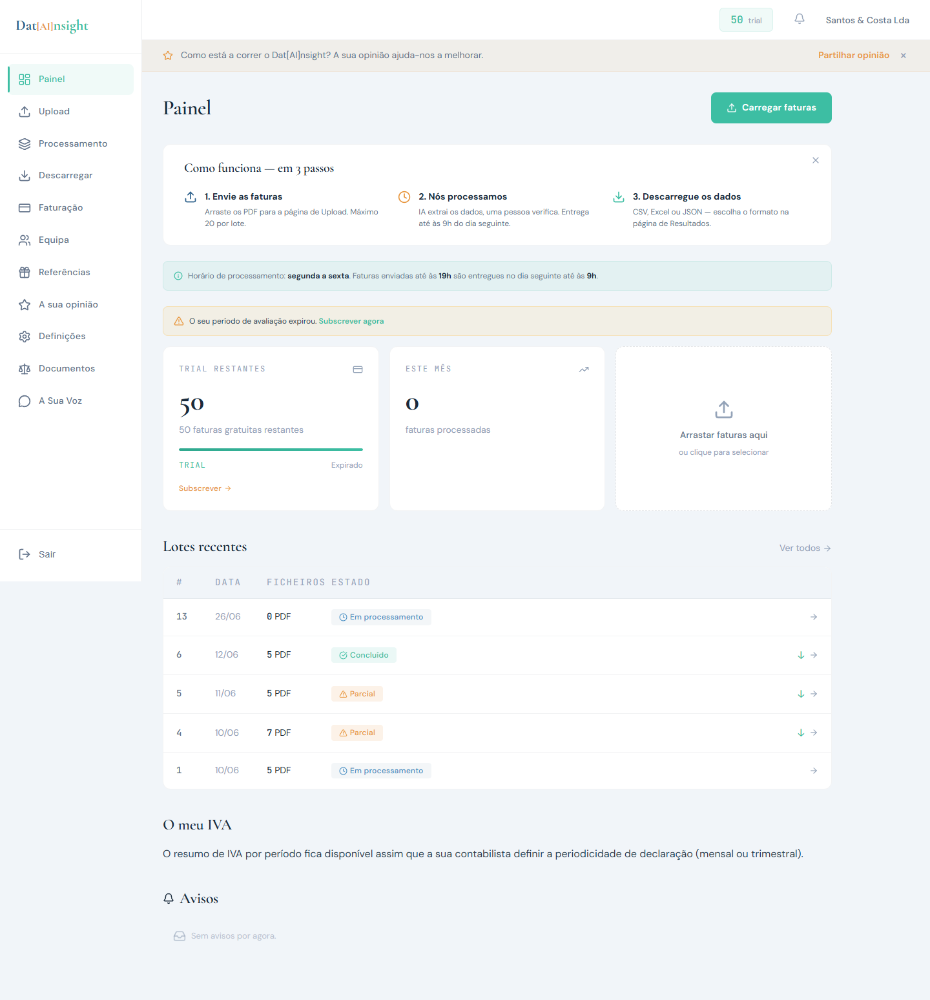 | 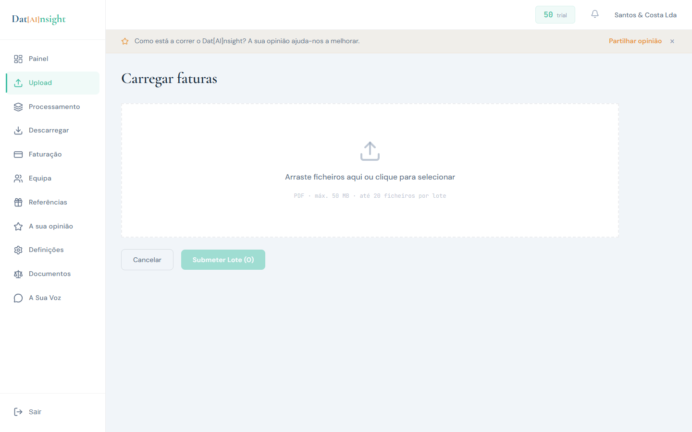 |
| **Műszerfal.** A működés három lépésben, a feldolgozási ablak (19:00-ig beküldve, 09:00-ra kész), a próbaidő állapota, a legutóbbi kötegek az állapotukkal. | **Feltöltés.** Húzd ide, csak PDF, fájlonként 50 MB, kötegenként 20 fájl; ami a szabályon kívül esik, azonnal visszautasul, indoklással. |
| 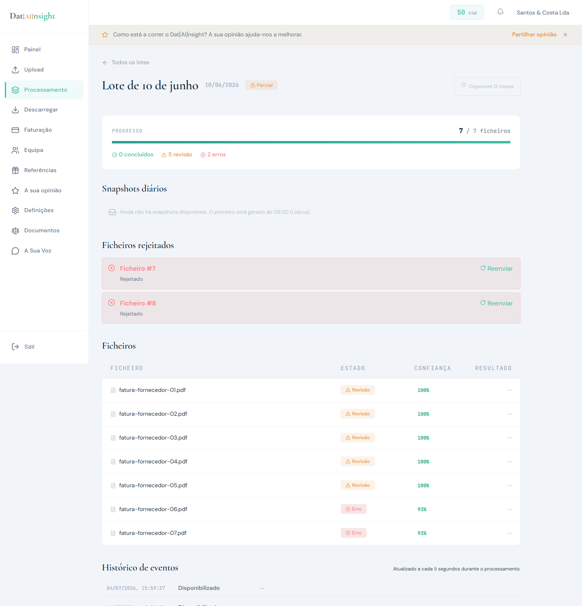 | 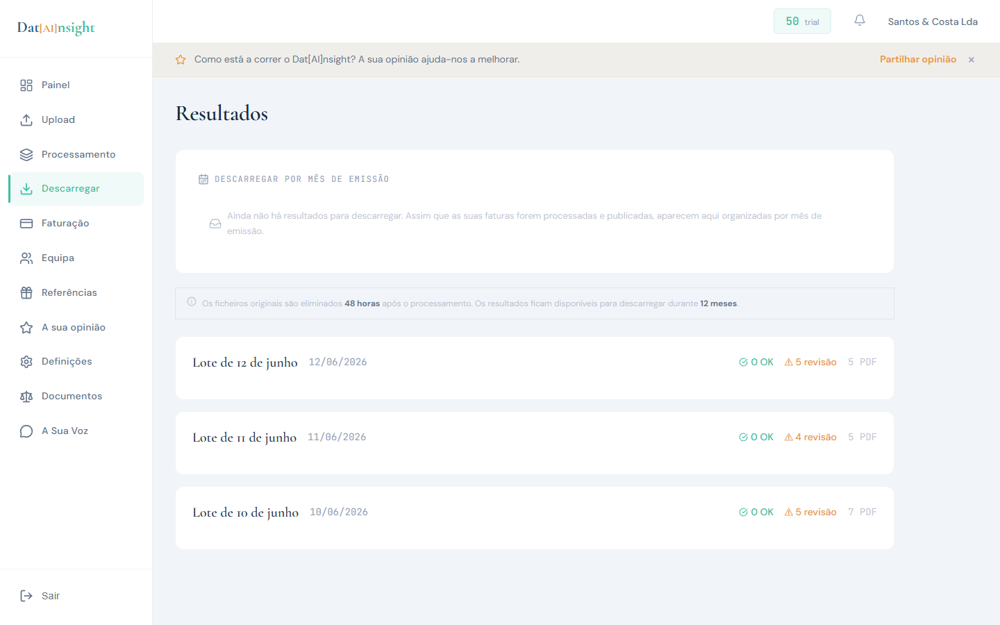 |
| **Egy köteg.** Haladás, visszautasított fájlok újraküldés-gombbal, minden fájl állapottal és megbízhatósággal, és egy eseménynapló, ami feldolgozás közben ötmásodpercenként frissül. | **Eredmények.** Kiállítási hónap szerint, formátumonként egy fájl. Az eredetiek a feldolgozás után 48 órával törlődnek, az eredmények 12 hónapig maradnak — ez a képernyőn áll, nem csak a feltételekben. |
| 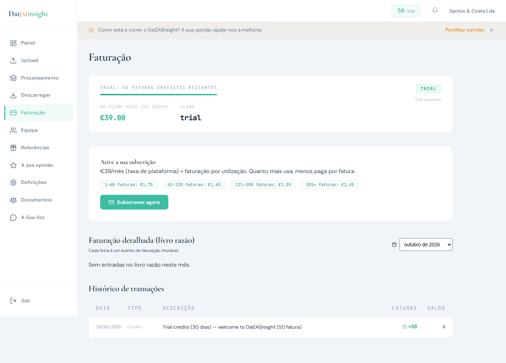 | 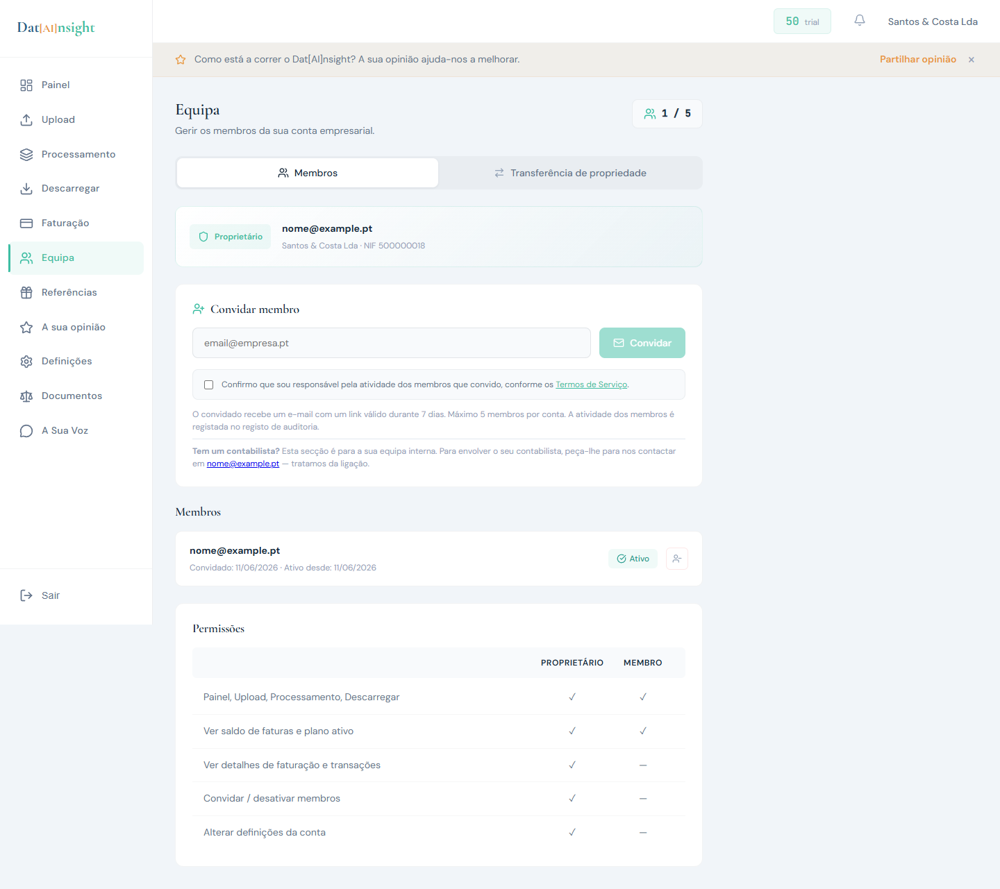 |
| **Számlázás.** A csomag, a sávos számlánkénti ár és egy módosíthatatlan napló hónapról hónapra — ugyanaz a napló, amit a pénz útja ír ([számlázás](10-billing.md)). | **Csapat.** Legfeljebb öt tag, jogosultsági tábla, tulajdonos-átadás megerősítéssel, és egy megjegyzés, hogy a könyvelőt *nem* itt kell hozzáadni. |

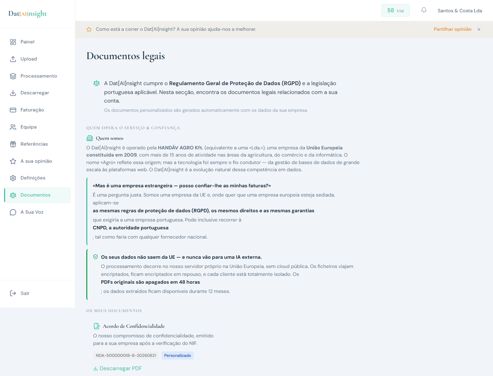

**Jogi dokumentumok** egy helyen: adatvédelem, sütik, GDPR-jogok, felhasználási feltételek, és az
adatfeldolgozási megállapodás letölthető PDF-ként. Egy süti-sáv minden opcionális süti (fizetés,
push-értesítés) előtt hozzájárulást kér.

## A könyvelő oldala

| | |
|---|---|
| 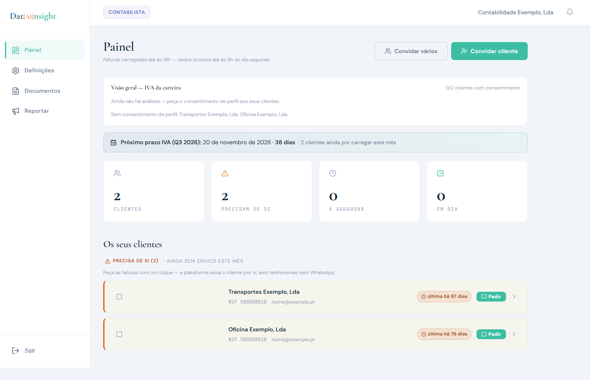 | 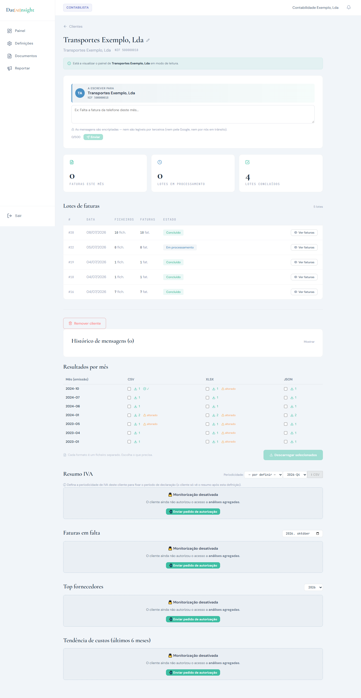 |
| **Portfólió-műszerfal.** Minden ügyfél egy képernyőn, aszerint rendezve, kinek van rá szüksége; a következő áfa-határidő a hátralévő napokkal; egy kattintás, és a késlekedő ügyfél értesítést kap — telefon nélkül. | **Ügyfél-részlet.** Üzenetdoboz az ügyfélnek, a kötegek, és egy hónap × formátum letöltési mátrix, ami *módosult*-nak jelöli a fájlt, ha a letöltése után újragenerálódott. Az elemzések zárva maradnak, amíg az ügyfél hozzá nem járul. |

## Tervezési döntések

| döntés | miért | ára |
|---|---|---|
| **Szolgáltatás, nem szoftver** — a felhasználó feltölt és letölt, semmit nem állít be | a vevő mikrovállalkozó, nincs ideje eszközt tanulni; magát a szoftvert soha nem akartam eladni — a szolgáltatást igen, ezért is futhatott saját hardveren | minden számla mögé feldolgozó lánc és ellenőrzés kell |
| **A feldolgozási ablak minden képernyőn ott van** (19:00-ig → 09:00-ra) | egyszer beállítja az elvárást, így a „hol az adatom?" sosem lesz hibajegy | nincs azonnali eredmény, akkor sem, ha a motor tudná |
| **Semmi nem hibázik némán** — a zárolt elem megmondja, *miért* zárolt, és felkínálja a következő lépést; a hozzájárulás nélküli ügyfelek név szerint szerepelnek, nem nullaként | a könyvelőnek abban is bíznia kell, amit *nem* lát | képernyőnként több állapotot kell megtervezni és tesztelni |
| **Formátumonként egy fájl, nincs ZIP** | senkinek nem kell egyszerre CSV, Excel és JSON; a könyvelőnek az kell, amit a programja beolvas | több letöltés-gomb |
| **A felhasználónak csak portugálul; a landing angolul is** | a piac Portugália; az első ügyfél előtt nem érte meg a teljes fordítási réteg | az appban nincs i18n-keret — egy második nyelv átalakítás lenne |
| **A megőrzés és a törlés a felületen áll** (48 óra az eredeti, 12 hónap az eredmény) | az adatvédelmi ígéret ott hihető, ahová a felhasználó néz | az ígéret köti a feldolgozó láncot — lásd [adatút](06-data-path.md) |

## Hogyan teszteltük

A felületet **persona-vezérelt böngésző-ügynökök** járták végig: három vállalkozó–könyvelő pár,
mindegyik ügynök csak annyit tudott, hogy „ez kiolvassa a számlák adatait", mindegyik új fiókkal,
pilot-készségi pontszámmal (cél: minden pár ≥ 80, blokkoló hiba nélkül). 2026 júniusa és júliusa
között hét kör futott. Az első valódi kör **15 hibát talált, ebből 4 blokkolót**. A mag-út —
meghívás, regisztráció, hozzájárulás, feltöltés, visszaszámlálás — mindkét persona szerint a
legerősebb rész volt; a törések a széleken jöttek (elavult teszt-fiók, hibás fizetés, belső címkék
egy exportban). **A készségi célt sosem értük el.**

## Terv vs megépült — őszintén

| terv | megépült |
|---|---|
| a webes portál telefonon | asztali gépre készült; telefonon a vállalkozói képernyők oldalra kilógnak. Mellette elindult egy kis kísérő-app feltöltésre és push-értesítésre |
| „az eredmények 12 hónapig maradnak", a letöltési képernyőn | az eredetiek 48 órás törlése megépült; a 12 hónapot kikényszerítő takarítás terv maradt ([adatút](06-data-path.md)) |
| második felületnyelv | csak portugál; a landing angolul is |
| persona-QA pontszám ≥ 80 élesítés előtt | 7 kör lefutott, a cél nem teljesült |
| ügyfél-elemzések a könyvelőnek (áfa-összesítő, hiányzó számlák, top szállítók, költség-trend) | megépült, hozzájáruláshoz kötve; valódi hozzájárulással sosem futott |

**Méret:** 40 képernyő (21 nyilvános, 12 vállalkozói, 7 könyvelői), kb. 13,7 ezer sor JSX és 9,4 ezer
sor CSS, 119 commit 2026 márciusa és augusztusa között.
