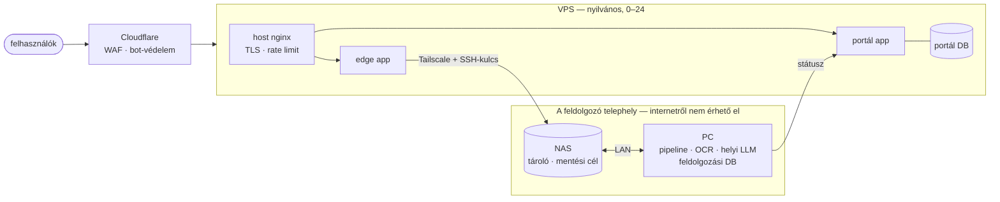

[English](../en/04-infrastructure.md) · **Magyar** · [↑ README](../../README.hu.md)

# Infrastruktúra — ami a pipeline-t hordozza

> **Egy mondatban:** a felhő nélküli ígéretet a topológia kényszeríti ki — a gép, amely a nyers
> számlát látja, helyben (on-prem) van, és az internetről nem érhető el; a nyilvános arc egy külön szerver,
> amely csak továbbít.
>
> *A topológia — melyik gép mit csinál, és hogyan adják át egymásnak az adatot — az én tervem.*

## Három csomópont, három feladat

| csomópont | mi fut rajta | miért ott |
|---|---|---|
| **VPS** | host nginx (TLS, rate limit), az edge app, a portál app, a portál-adatbázis, a webes felület | Mindig elérhetőnek kell lennie — és feláldozhatónak. |
| **NAS** | beérkező fájlok, kimenő eredmények, mentések | Tároló, amit mindkét oldal elér, anélkül, hogy egymást közvetlenül elérnék. |
| **PC** | a teljes feldolgozás: kiolvasó, OCR, helyi LLM, feladatsorok, feldolgozási adatbázis, ellenőrző pult | A nyers adat a saját hardveremen marad. |

## A kapcsolatok

| kapcsolat | szerep | döntés |
|---|---|---|
| **Cloudflare → VPS** | a bejárati ajtó: TLS, webes tűzfal, bot-védelem | A visszaélést elnyelni, mielőtt a szerverhez ér. |
| **Tailscale VPS ↔ NAS** | a belső folyosó: a VPS SSH-n teszi le a fájlt a NAS-ra | Egy külön WireGuard-réteget kivezettem — a Tailscale maga is WireGuard; kettő belőle duplán konfigurál, haszon nélkül. Vészút Tailscale-kiesésre: SSH-lehúzás. |
| **LAN NAS ↔ PC** | a feldolgozó telephelyen belül | Két, ugyanazon a switchen lévő gép közé nem kell overlay-hálózat. |

## Izoláció — kimondva, aztán megmérve

Az elv: **alapból tiltás, csak engedélylista; a feldolgozó gépek soha nem érhetők el az
internetről.** Az API előtt az nginx külön rate limitet tart az általános forgalomra, a
hitelesítésre (5/perc) és a regisztrációra (10/perc).

Egy elv csak állítás, amíg valaki meg nem támadja. 2026 szeptemberében kívülről szkenneltem a
telephelyet (2026. szeptember 11., a VPS-ről, SYN-szkennelés a 100 leggyakoribb TCP-portra): **a
feldolgozó telephelyen nulla nyitott TCP-port**, az UDP némán eldobva, és a port-szkennelési
csapda 20 másodpercen belül elkapta a szkennelést. A VPS-en csak a webes portok és az SSH
látszottak. Az első két szkennelés a mérésről is tanított: mindkettő „tiszta nullát" adott rossz
okból (a szkennelési mód mellékterméke, illetve a csapda félreértett időablaka) — a receptet
kijavítottam, mielőtt az eredményben megbíztam volna.

## Telepítés

- **Két alkalmazás a VPS-en, szándékosan:** egy vékony *edge* (feltöltés, push-értesítés,
  levél-webhookok) és a *portál* (minden, amit a felhasználó lát). A feltört edge nem éri el az
  ügyféladat-logikát, és mindkét app csak a saját függőségeit hozza.
- **Host nginx, nem konténer**, a tanúsítványt a host újítja meg.
- **Telepítő szkript:** adatbázis-migráció → konténerek újraépítése és újraindítása →
  egészség-ellenőrzés. A kód rsync-kel jutott a VPS-re, nem gittel — ismert kompromisszum,
  adósságként listázva.
- **A drift-lista mint módszer.** Amikor az éles telepítés elcsúszott a dokumentumaitól,
  SSH-n átvilágítottam a szervert, és számozott listát vezettem (24 tétel) minden eltérésről,
  státusszal: lezárva, részleges, halasztva. Hét telepítési fázis egyetlen nap alatt zárta le
  a zömét.

## Mentés és katasztrófa-helyreállítás

| szint | mi | állapot |
|---|---|---|
| 0 | VPS-szolgáltatói pillanatképek (4 napi) | megépült |
| 1 | NAS: adatbázis-dumpok és kötetek a PC-ről és a VPS-ről, **age-titkosítva**, 14 napi + 4 heti + 12 havi | megépült |
| 2 | második, telephelyen kívüli NAS | tervezve |
| — | **telephelyen kívüli git:** a teljes történet ellenőrzött `git bundle`-je egy hálózattól elzárt külső meghajtón, minden munkanap után; git-remote egyáltalán nincs | megépült |

A visszafejtő privát kulcs csak jelszókezelőben és papíron létezik. A VPS adatbázis-kötetei
ezen felül LUKS-titkosítottak.

**A 17 napos néma hiba.** Egy NAS-frissítés után a mentési felhasználó elvesztette a shelljét;
az SSH-kulcsot még elfogadta a rendszer, így a munkamenet megnyílt, és azonnal be is zárult.
17 napon át a mentési feladat 412 hibajelzést küldött a monitorozó szolgáltatásnak — amelyhez
nem volt riasztási csatorna beállítva. Semmi nem szólt. A tanulság, ami azóta szabály: *a
hibajelzés csak akkor valódi, ha valaki megkapja* — minden ellenőrzésnek meg kell neveznie a
csatornáját, és a csatornát tesztelni kell.

## Monitorozás

- Prometheus, Alertmanager, Grafana és node-exporter, riasztási szabályokkal a mentésekre
  (elavult, sikertelen, méret-anomália, hiányzó szívverés, off-site késés, visszaállítási próba),
  a rendszer-erőforrásokra, a QA-arányra, a kiolvasási pontosságra és a build-trendekre.
- **Halott-ember kapcsoló** a telephelyen kívül (5 percenkénti szívverés, 20 perc türelmi idő): maga a
  csend riaszt.

## Terv vs megépült — őszintén

| tervezve | megépült |
|---|---|
| monitorozás mindig bekapcsolva | a megfigyelési stack egy Compose-profil mögött ült, és alapból nem indult el |
| havi automatikus visszaállítási próba | a riasztási szabály létezik, a próba nem |
| második, telephelyen kívüli NAS | tervezve |
| git-alapú telepítés a VPS-re | rsync, a sablonok és a szkriptek alapja gitben |
| Cloudflare elöl, a forrásszerver rejtve | a VPS forrásszervere közvetlenül, a Cloudflare tűzfalát megkerülve is elérhető maradt — a külső szkennelés találta meg; közepes súlyú, a projekt lezárásakor nyitva maradt |
