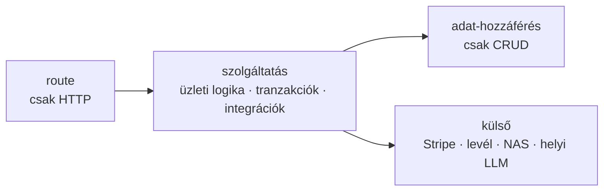

[English](../en/04b-platform.md) · **Magyar** · [↑ README](../../README.hu.md)

# A platform

> **Egy mondatban:** rétegzett szolgáltatás-platform a motor körül — és folyamatos küzdelem azért,
> hogy a rétegek tiszták maradjanak, miközben egy AI-csapat nagy sebességgel írta a kódot.

## A rétegzési szabály

- A **route** deklarálja a végpontot, validálja a bemenetet, injektálja a függőségeket, hív egy
  szolgáltatást, és 4xx-et dob.
- A **szolgáltatás** birtokolja az üzleti döntéseket, a tranzakciókat, az újrapróbálásokat és
  minden külső hívást.
- Az **adat-hozzáférés** létrehoz, olvas, módosít, töröl — semmi mást.
- A függőségek injektálva érkeznek, nem globálisként importálva, így egy szolgáltatás szerver
  nélkül is tesztelhető.

**Miért számított ez a szokásosnál többet:** egy AI-ügynök úgy ír a leggyorsabban működő
végpontot, hogy a lekérdezést egyenesen a route-ba teszi. Gyors és rossz — az üzleti szabályok
szétszóródnak 70 fájlban.

## Megmérve, aztán lépcsőnként javítva

2026 májusában egy architektúra-drift audit vetette össze a kódot a szabállyal. Erre a
lenyomatra újramérve: **70 route-fájlból 55** még közvetlenül beszél az adatbázissal — a drift
nagyobb volt, mint az audit első becslése.

A válasz lépcső volt, nem újraírás:

| lépcső | mi | állapot |
|---|---|---|
| 1–4 | előkészítő lépések, a végén a bemeneti ellenőrzés kiemelése saját csomagba | kész |
| pilot-kötelező | a számlázási újrapróbáló ciklus kikerült a pipeline-ból — a számlázható események egy főkönyvi szolgáltatásba mennek | kész |
| 5a | alapvonal a portugál pipeline-ra: 10/10 arany-számla bitre azonos, mielőtt bármihez hozzányúlunk | kész |
| 5b | a 418 soros perzisztencia-blokk a feladatból saját szolgáltatásba költözött — a feladat 1 482 sorról 1 106-ra csökkent, a kimenet bitre azonos | kész |
| 6 | a maradék route-szintű drift | a pilot utánra halasztva |
| — | **új kód:** minden új route-nak követnie kell a szabályt, devils-advocate review-val a tervezéskor és a commit előtt | kikényszerítve |

A lényeg nem a darabszám, hanem a sorrend: a viselkedés befagyasztása (bitre azonos alapvonal),
egy blokk áthelyezése, annak bizonyítása, hogy semmi nem változott, commit — aztán a következő.

## Identitás és hozzáférés

- **Egyetlen jogosultság-feloldó** válaszol minden „láthatja-e ez a felhasználó ezt az ügyfelet?"
  kérdésre.
- **Karakterizációs tesztek** alatt vezettük be: 14 teszt rögzítette a régi viselkedést, és 3
  differenciál-orákulum teszt vetette össze a régi és az új válaszát — nulla regresszió az átállásnál.
- A felhasználók három adatbázisban léteznek; egy **identitás-térkép** köti egy személyhez egy
  identitást mindhárom között.
- Az ügyfélhatáron átnyúló tesztek kifejezetten a könyvelői utakat célozzák (hozzáférés
  kapcsolattal, profilozás hozzájárulással).
- A nyitott pontok rangsorolt listában vannak leírva (a hozzájárulás kemény kapu legyen, ne
  formalitás; hibás identitás-egyezésnél zárt hibázás; szerepkör-kényszer adatbázis-szinten) — és
  az erre épülő adatbázis-híd addig blokkolva maradt, amíg ezekről döntés nem születik.

## A felületek

| felület | kinek | stack |
|---|---|---|
| ügyfél-webapp | Pedro (vállalkozó) és Maria (könyvelő) — 34 oldal | React 19, Vite |
| belső webapp | séma-készítés és fejlesztői eszközök | React 19, Vite, Tailwind, Vitest, Playwright |
| mobilapp | Pedro — push-értesítés, státusz | Flutter, Firebase Cloud Messaging |
| operátori konzol | az operátor — KPI-k, sorok | Streamlit |

## Tesztek

3 690 tesztfüggvény a repóban, ebből nagyjából 3 000 a `tests/` alatt, rétegek szerint szervezve — API, architektúra,
diszpécser, bemenet, OCR, kiolvasás, adatvédelem, profilok, QR-adapterek, sorok, útválasztás,
szolgáltatások, feladatok —, plusz integrációs tesztek, amelyek a teljes feldolgozó konténerben
futnak. Az egységtesztek egy vékony fejlesztői konténerben futnak; ami Javát (Tabula),
OpenCV-t/Tesseractot vagy a feladatsort igényli, az ott fut, ahol ezek élnek.

## Terv vs megépült — őszintén

| tervezve | megépült |
|---|---|
| request-ID middleware a kérés naplókon átívelő követésére | nem épült meg |
| architektúra-invariáns tesztcsomag | 2 teszt (státusz-kisbetű, migrációs tűzfal) |
| „23 végponttól végpontig böngészőteszt" egy régebbi státusz-dokumentumban | 2 Playwright-spec a repóban |
| közvetlen adatbázis-hozzáférés nélküli route-réteg | az új kódra igaz; 55 régi route-fájl halasztva |
