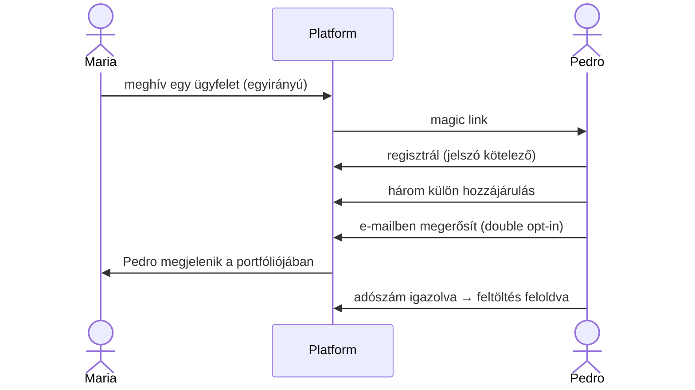

[English](../en/05-two-sided-product.md) · **Magyar** · [↑ README](../../README.hu.md)

# Kétoldalú termék

> **Egy mondatban:** a vállalkozó fizet, a könyvelő nem — mert a könyvelő egyszerre a csatorna,
> a célzás és a minőség bírája.

## Két felhasználó, szándékosan nem egyenrangúan

| | **Maria** — könyvelő | **Pedro** — vállalkozó |
|---|---|---|
| szerepe az üzletben | csatorna + célzás | a fizető |
| fizet | **nem** | **igen** — havi €39 + számlánként |
| a fájdalma | adatbevitel, a hiányzó bizonylatok utáni szaladgálás, határidők | „a könyvelőm folyton papírokat kér", „nem tudom, hol állok" |
| megtaláljuk? | **igen** — a könyvelőirodák nyilvános jegyzéke | **alig** — több százezer, egymástól megkülönböztethetetlen mikrovállalkozás |
| egyedül dönt? | igen | **nem** — ha Maria nem fogadja el a kimenetet, neki értéktelen |
| amit a termék ígér | „minden ügyfelem egy képernyőn; két kattintás, és szólok annak, aki elmaradt" | „bedobom a PDF-et, kapok egy értesítést, kész" |

**Miért az aszimmetria.** A legjobb belépési pont — a külföldi számla, ahol a PDF az egyetlen
forrás — kívülről láthatatlan: egy pékség weboldaláról nem derül ki, hogy olasz lisztet vesz.
Maria pontosan tudja, melyik ügyfelének van ilyen számlája. És egy könyvelő megnyerése a teljes
ügyfélkörét hozhatja. Ezért Maria az első, és Pedro fizet.

## A meghívási ív

- **Csak egy irányban:** a könyvelő hív meg; vállalkozó nem kapcsolhatja magát könyvelőhöz.
- **Egy fiók, egy szerep.** A könyvelő sok ügyfelet szolgál ki egy kifejezett kapcsolótáblán át.
- **A hozzájárulás rekord**, megváltoztathatatlan, célonként — nem egy jelölőnégyzet állapota.
- **Maria soha nem látja a számlázást:** kredit, csomag, fizetési állapot Pedróé marad.

## Mit lát egyikük és másikuk

- **Maria:** irányítópult három sávban — *figyelmet kér · jóváhagyásra vár · kész* —, és
  ügyfelenként: kötegek, export-csomagok, ÁFA-összesítő, beszállítói profil, trendek,
  riasztások és egy üzenetmező.
- **Pedro:** feltöltés, és státusz egyszerű szavakkal — *feldolgozás alatt · elfogadva ·
  ellenőrzés alatt · elutasítva*. A „human in the loop" kifejezést soha nem látja. Push-értesítés
  a telefonján.

## Üzenetküldés — öt döntés

1. **Maria szabadon ír.** Egy korai változat üzenetsablonokat kínált; kivettük őket. Az üzenet
   *az ő nevében* megy *az ő ügyfelének* — mi az infrastruktúrája vagyunk, nem a szerkesztője.
2. **Technikai plafon, nem üzleti:** könyvelőnként napi 1 000 üzenet, egy eltérített fiók ellen —
   nem a munkáját korlátozza.
3. **Olvasási visszaigazolás** — elküldve / elolvasva.
4. **Rendszer-push csak akkor, ha valami akadályoz:** sikertelen fizetés, lejáró próbaidő,
   sikertelen adószám-ellenőrzés, lejárt tartozás, felfüggesztett fiók — és Maria üzenetei.
   Semmi más nem szakít meg.
5. **A support márka-láthatatlan:** „az ügyfélszolgálat" — nem egy alapító neve.

## Két közönség, két bejárat — és egy harmadik olvasó

- **Könyvelőknek:** a nyilvános (portugál) landing az irodához szól: mit nyer, hogyan működik,
  *az adatai biztonságban maradnak*, mennyibe kerül, és a nyitott kifogásokra adott válaszok.
- **Vállalkozóknak:** az értékesítési oldalt egy portugál kisvállalkozó szemszögéből elemeztük,
  mielőtt egy sort is írtunk volna.
- **AI-asszisztenseknek:** szándékosan beterveztünk egy harmadik olvasót — `llms.txt`, a hero
  egy entitás-definíció, egy *pontosság és korlátok* blokk —, mert a vevők egyre inkább egy
  asszisztenst kérdeznek, mielőtt weboldalt nyitnának.

## Ajánlói program

A vállalkozói oldali ajánlói program megépült: mindkét fél bónusz-számlákat kap, egy szint
mélyen, 30 nap után aktiválódik, hét csalás-szabály védi. A könyvelőnek nem jár jutalék —
**a jutalma maga a szolgáltatás, ingyen**, és kizárólag a vállalkozó fizet. A jutalék etikátlanná
tette volna a rendszert: a könyvelő az ügyfele bizalmi tanácsadója és a kimenetünk bírája; ha pénzt
kapna azért, hogy minket ajánljon, összeférhetetlenbe kerülne.

## Terv vs megépült — őszintén

| tervezve | megépült |
|---|---|
| a „hiányzó számlák" lista Maria képernyőjén — a későbbi érték-tézis magja | nem épült meg; az ellenőrző pult operátor-only maradt |
| lead-forrásonkénti landing-változatok | tervezve |
| teljes olvasási visszaigazolás mindkét irányban | részleges |
