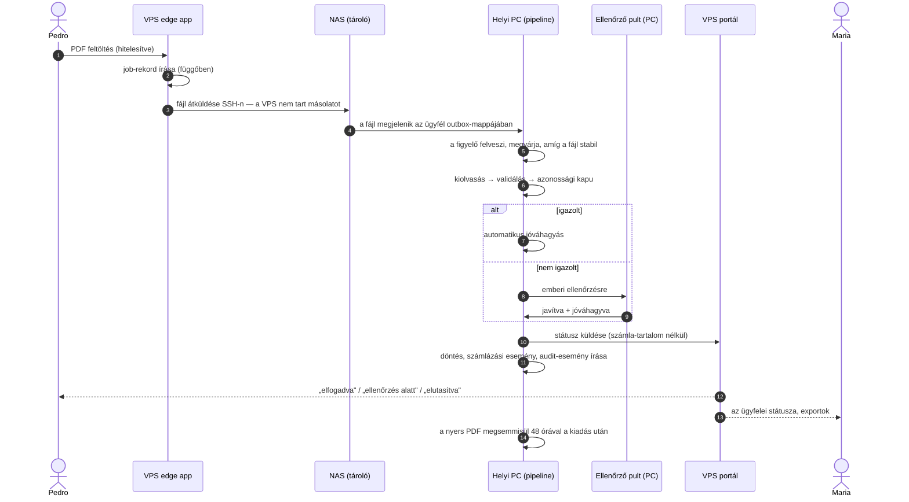

[English](../en/06-data-path.md) · **Magyar** · [↑ README](../../README.hu.md)

# Az adat útja

> **Egy mondatban:** a nyers számla befelé utazik egyetlen gépig, és csak ott dolgozódik fel;
> a nyilvános oldalra csak státusz és maszkolt metaadat jut vissza — kiolvasott érték kizárólag a
> vállalkozó és a könyvelő saját export-csomagjaiban hagyja el a telephelyet.
>
> *A három gépen átívelő híd az én tervem; az ügynökök e terv szerint építették meg.*

## Egy számla útja

## Lépésről lépésre — és a döntés minden lépés mögött

| lépés | mi történik | a döntés |
|---|---|---|
| **Feltöltés** | Az edge app hitelesíti az ügyfelet, job-rekordot ír, és a fájlt a NAS-ra küldi az `ügyfél / outbox / job_id` helyre. Ha a NAS nem érhető el, a job hibára fut, az ügyfél újrapróbálási kérést kap. | A nyilvános szerver **soha nem tárol számlafájlt vagy számla-értéket** — csak fiók- és job-rekordokat. Ha elveszik vagy feltörik, számla nem kerül ki. |
| **Átadás** | A PC-n egy figyelő szolgáltatás végignézi az ügyfelek outbox-mappáit, megvárja, amíg a fájl mérete nem nő tovább, majd felveszi. | Mappa-szerződés a gépek között hálózati API helyett: a PC-t kívülről soha senki nem hívja. |
| **Feldolgozás** | Kiolvasás, validálás és az azonossági kapu csak a PC-n fut. → [Kiolvasó motor](04-parsing-engine.md), [Bizalom](05-trust.md) | A nyers adat pontosan egy helyen dolgozódik fel. |
| **Ellenőrzés** | A bizonytalan mezők egy operátori pultra mennek a PC-n. | Az ember a valódi értékeket csak azon a gépen látja, amelyik tárolja őket. |
| **Státusz vissza** | A PC kifelé indított, API-kulccsal hitelesített HTTPS-kéréssel küldi a státuszt a portálnak; a döntés-rekord a mezők *nevét* és hash-ét őrzi, az értékek redaktálva. | A kifelé menő csatorna felépítésénél fogva nem visz tartalmat, nem szabály alapján. |
| **Kézbesítés** | Napi export-csomagok a vállalkozónak és a könyvelőnek; a PC-n készülnek, a NAS-on tárolódnak, és a portál a bejelentkezett felhasználónak streameli őket. | Ez az egyetlen út, amelyen kiolvasott érték elhagyja a telephelyet — ahhoz a két emberhez, akié. |
| **Megsemmisítés** | Óránként fut egy takarító, amely a nyers PDF-et 48 órával a kiadás után megsemmisíti. | Az eredményt tartjuk meg, nem a forrást. |

## Mi lépi át melyik határt

Minden kapcsolat titkosított. A tábla azt mondja meg, hol *olvasható* az adat útközben, és hol marad meg.

| adat | nyilvános szakasz (felhasználó → Cloudflare → VPS) | belső szakasz (VPS → NAS, Tailscale) | telephely (NAS, PC) | hol tárolódik |
|---|---|---|---|---|
| feltöltött PDF | memóriában olvasható a Cloudflare peremén (TLS-bontás a tűzfalhoz) és a VPS-en, amíg átfolyik rajta | végig titkosított | a PC-n dolgozódik fel | NAS → PC, a kiadás után 48 órával megsemmisül |
| kiolvasott értékek | — | — | csak a PC-n | a PC feldolgozási DB-je; a vállalkozó és a könyvelő export-csomagjai |
| export-csomagok | TLS-en a bejelentkezett vállalkozónak vagy könyvelőnek | NAS → portál, kérésre | a PC-n készülnek | NAS |
| státusz és maszkolt metaadat | portál | a PC küldi | — | portál-DB (vetület) |
| fiókadatok (felhasználók, hozzájárulások, kapcsolatok) | portál | — | identitás-térkép a PC-n | portál-DB, edge-DB |
| közösségi adószám (fordított adózáshoz) | az EU VIES-szolgáltatásnak megy | — | — | ellenőrzési napló, bizonyítékként |
| fizetés | a Stripe kezeli — kártyaadat a szervereinket soha nem érinti | — | — | Stripe; számlázási események a főkönyvünkben |

**A kompromisszum, kimondva:** a Cloudflare a peremén bontja a TLS-t, hogy a tűzfala és a
bot-védelme át tudja vizsgálni a kéréseket. Ezzel a Cloudflare a feltöltés útközbeni
adatfeldolgozója — nem tárolja. A telephelyre vezető belső szakaszt a saját gépeinken kívül semmi
nem fejti vissza. Egy rossz pillanatban érkező összeomlás vagy mentés hagyhat a VPS-en egy
feltöltés-töredéket; szándékosan semmi nem ír oda.

## A híd — hogyan hibázik biztonságosan

Az átadás minden hibamódjának meghatározott kimenete van.

| mi romlik el | mi történik |
|---|---|
| a NAS nem érhető el feltöltéskor | a job hibára fut, az ügyfél *próbálja később* választ kap (HTTP 503 + Retry-After) |
| a fájl még íródik | a figyelő megvárja, amíg a mérete stabil (30 mp); különben kihagyja, és a következő kör újrapróbálja |
| ugyanaz a fájl kétszer látszik (lekérdezés és fájl-esemény) | jelzőfájlok (`.done`, `.failed`, `.destroyed`) akadályozzák meg a második feldolgozást |
| a PC feldolgozás közben összeomlik | a PDF az outboxban marad; a következő kör újrafuttatja, az írás job-azonosítóra kulcsolt, idempotens upsert |
| ugyanazt a számlát újra feltöltik | egy duplikátum-kapu (ATCUD) ellenőrzés előtt elnyomja; a vállalkozó *duplikátum* jelzést lát |
| a portál nem érhető el | a státusz-küldés legjobb igyekezet szerinti; a feldolgozás soha nem függ tőle; a PC-n lévő döntés marad az igazság forrása |
| sorrend | a döntés **előbb** mentődik, csak utána megy ki a státusz — státusz soha nem jelenthet be nem létező döntést |
| végleges hiba | a PDF `.failed` jelzővel marad, audithoz és kézi újrapróbáláshoz |
| megőrzés | óránkénti takarító semmisíti meg a nyers PDF-et 48 órával a kiadás után |

## Három adatbázis, három szerep

| adatbázis | gép | szerep |
|---|---|---|
| edge DB (SQLite) | VPS | feltöltési jobok, eszköz-tokenek, edge-hitelesítés |
| portál DB (Postgres) | VPS | amit a felhasználók látnak — **vetület**, főként olvasásra |
| feldolgozási DB (Postgres) | PC | **az igazság forrása**: döntések, számlázási főkönyv, ellenőrzés, audit-események |

Ugyanazt a route-kódot különböző alkalmazások különböző adatbázisokhoz kötve töltik be. Ettől
lett rugalmas a szétválasztás — és ebből lett a projekt legdrágább hibaosztálya is: a rossz
adatbázison futó javítás nulla sort ad vissza, és sikernek látszik.

## Terv vs megépült — őszintén

| tervezve | megépült |
|---|---|
| csak titkosított export-csomagok | a titkosított út ütemezve futott; egy újabb út sima fájlokat tartott a NAS-on (a telephelyen belül), és kérésre streamelte őket |
| 12 hónapos gördülő megőrzés havi takarítással | a nyers PDF 48 órás megsemmisítése megépült; a 12 hónapos takarítás terv maradt |
| SFTP-átvitel a NAS-ra | SSH-exec stream (a NAS SFTP-szolgáltatása ki volt kapcsolva) — kulccsal védve, de SFTP-chroot nélkül |

Ezek leírása a módszer része volt: egy tervdokumentum, amely csendben ellentmond a kódnak,
rosszabb, mint ha nem is lenne.
