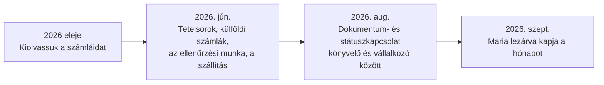

[English](../en/06-market-and-pricing.md) · **Magyar** · [↑ README](../../README.hu.md)

# Piac és árazás

> **Egy mondatban:** az érték-tézis négyszer mozdult el, minden alkalommal azért, mert egy mérés
> vagy egy jogszabály megmutatta, hogy az előző gyengébb, mint látszott — és az árazás ugyanezt az utat járta.

## Hogyan mozdult az érték-tézis

| lépés | mit tanultunk | következmény |
|---|---|---|
| **1 → 2** | A kereslet bizonyított — vannak fizető inkumbensek, és pont ezért a munkáért kérnek pénzt. A kockázat a verseny. De a dokumentum-AI specialisták a nagyvállalati piac felé mentek (egyiküket felvásárolták, és csak egyedi ajánlatra árazott), a kis könyvelők sarka szabadon maradt. **És** a portugál e-számla rendszer minden belföldi számla fejlécét és ÁFA-ját már eljuttatja az államhoz — a könyvelő enélkül is megkapja. | A fejléc-kiolvasás Portugáliában nem termék. A rés: tételsorok, külföldi számlák, az ellenőrzési munka, a szállítás a könyvelőprogramba. |
| **2 → 3** | Az állam **szándékosan** nem gyűjti a tételsorokat — az adóhatóság saját e-Fatura tájékoztatója a személyes adatok védelmére hivatkozik [S3]; a portugál rendszer fogyasztó-központú, és egy tételszintű országos adatbázis a teljes lakosságot profilozná. Magyarország az ellenkezőjét választotta. | A tételsor törvényi rés, nem hanyagság. A pozíció a könyvelő és a vállalkozó közti kapcsolat lesz: dokumentumok, státusz, ami hiányzik. Érési út: beérkeztető eszköz → beérkeztető központ → megfelelőségi munkafolyamat. |
| **3 → 4** | A könyvelők szakmai testületének elnöke számokban mondta ki a fájdalmat: a könyvelő idejének 20–30 %-a a dokumentumok utáni szaladgálással megy el [S1, S2]. A vezető könyvelőprogramban már van „hiányzó dokumentumok" bekérése — a hónap után, e-mailben [S4]. | A szolgáltatás: *a hónap lezárva érkezik* — ami várható, beérkezett; ami beérkezett, kiolvasva és ellenőrizve; amit senki listája nem lát, jelezve; és mindez a könyvelő programjában. |

## Árazás — csomagokból sávos mérésig

**A csapda.** Az első modell fix csomagokat árult (havi €175 / €495 / €1 500 a 100 / 300 / 1 000
számlára). Az ügyfelek ritkán használták el pontosan a keretet; a kredit felhalmozódott, és a 46
fel nem használt kredittel rendelkező ügyfél megkérdezte: „minek fizessek ebben a hónapban?" — és
lemondta. *A termék saját maga ellen dolgozott.*

**Négy modellt vetettünk össze:** fix csomag · tiszta használat-alapú · hibrid választott sávval
· hibrid automatikus, progresszív sávokkal. **A választott: €39 platformdíj + sávos használat** —
1–60 számla €1,75, 61–120 €1,65, 121–300 €1,55, 301+ €1,45. Az ár magától csökken, ahogy nő a
volumen; semmi nincs előre kifizetve, semmi nem vész el. A számított optimum €49 volt; a €39
bevezető árként jelent meg.

**A későbbi összehasonlítás** dokumentumonkénti árakat vetett össze: a tiszta kiolvasó eszközök a
miénk töredékéért dolgoznak. A következtetés: nem a kiolvasás árában versenyzünk — **az
ember által ellenőrzött eredményt adjuk el**, nem az olvasást. A sávos havi csomag volt a következő
ötlet; nyitva maradt.

## A könyvelő × vállalkozó kombináció

- **Bevétel = könyvelők × ügyfél/könyvelő × számla/ügyfél × ár.** A kar az első kettő: egy
  könyvelő megnyerése, és a teljes ügyfélkörének tömeges meghívása. A számlák száma kimenet, nem kar.
- **Közel nulla ügyfélszerzési költség** a könyvelői csatornán — ezt az utat járták az inkumbensek is.
- **A könyvelő mint társ-szolgáltató:** a vállalkozó és a hatóságok között áll; mi mindkettejük
  infrastruktúrája vagyunk. Ő ingyen használja; kizárólag a vállalkozó fizet.

## Unit-economics — minek kellett igaznak lennie

- **Kivétel-alapú ellenőrzés, nem teljes:** a modell automatikusan elfogadja, amit igazolni tud;
  a többit ember intézi. Havi ~200 számla alatt a hibrid ember-gép megoldás nyer; ~500 felett az
  automatizálás. A kis ügyfeleink (havi 12–70) a hibrid zónában vannak.
- **A fő mérőszám az első naptól: emberi perc számlánként az időben.** Ha a volumennel csökken, a
  modell skálázódik; ha lapos marad, a haszon munkadíj-haszon.
- **A hardver fix költség:** felhő nélkül a feldolgozó gép a volumennel amortizálódik. Egy GPU-s
  gép helyi kép-nyelvi modellekhez tervben volt — a bevételből finanszírozva, nem előtte.
- **Egy második piac mint opció:** az USA-ban nincs e-számla rendszer, így ott a kiolvasás
  megtartja a teljes értékét — de a felhő nélküli megkülönböztetés nem utazik vele. „Később
  mutálódni", nem pivot.

## A szabályozási ablak

A kisvállalkozók 2026 végéig még sima PDF-számlát állíthatnak ki; 2027-től strukturált e-számla
és minősített aláírás jön (13-A/2025. törvényerejű rendelet) — egy határidő, amit korábban már elhalasztottak. A külföldi és a
fogyasztói számlák mindkét esetben kívül maradnak. Az ablak valós volt, de záródott.

## Piacra lépés mint mérőgép

- **Csatornatérkép** — hideg e-mail, utókövetés, fórumok, könyvelőprogram-partnerek, a szakmai
  testület, tartalom, fizetett —, **kilépési kapukkal ellátott hullámokban** nyitva, nem dátumok
  szerint: egy csatornán maradunk, amíg fizetőt nem hoz, vagy a válaszaránya 150 megkeresés után
  bizonyíthatóan 1 % alatt nincs.
- **Listaépítés bizonyíték-törvénnyel:** egy kitalált domain nem igazolhatja önmagát — független
  jel kell (a cégjegyzékszám az oldalon, a szakmai nyilvántartás bejegyzése).
- **Népszámlálás, nem mintavétel;** minden arányhoz konfidencia-intervallum; **a döntési
  küszöbök leírva, mielőtt az adatot megnéznénk;** visszapattanási kapu minden küldés előtt.
- Eredmény: ~240 levél, emberi válasz nélkül — az alatt a méret alatt, amelyen a csatorna tisztán
  el tudott volna bukni. → [Post-mortem](09-post-mortem.md)

## A jogi réteg

A pilotra elkészült tervezetek, az ügyfél felé szólók portugálul is: adatfeldolgozási szerződés
könyvelői kiegészítéssel, felhasználási feltételek, adatvédelmi és süti-szabályzat, elfogadható
használat, hozzájárulás-kezelés, fióktörlési protokoll, alvállalkozói lista, megőrzési összesítő,
adatkezelési nyilvántartás, két hatásvizsgálat (profilozás; törlés és átadás), jogos érdek
mérlegelések (profilozás; hideg megkeresés), incidenskezelési terv, titoktartási megállapodások.

## Megmentendő ötletek

1. **A hiányzó-számla lista mint mag**, az ügyfél saját előzményeiből előre jelezve — a
   könyvelő meglepetését a hónap utánról a hónap közbenre hozza.
2. **„A hónap lezárva érkezik"** — szolgáltatás-definíció, nem szoftverfunkció.
3. **A könyvelő mint célzási mechanizmus** egy kívülről láthatatlan belépési ponthoz.
4. **Sávos mérés** csomagok helyett — nincs kredit-csapda.
5. **Bizonyíték-törvény az értékesítési listákra**, és az adat előtt rögzített döntési küszöbök.
