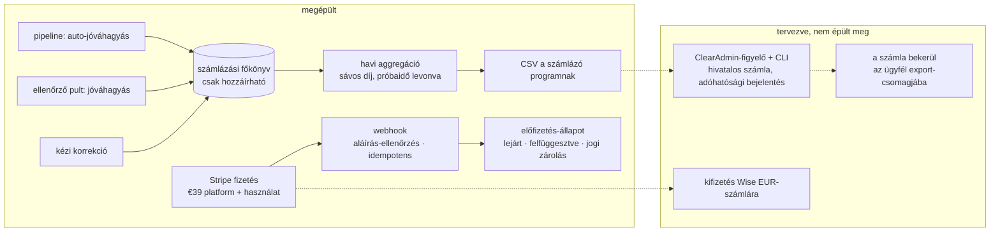

[English](../en/10-billing.md) · **Magyar** · [↑ README](../../README.hu.md)

# Számlázás — a pénz útja

> **Egy mondatban:** a fizetési szolgáltató beszedi a pénzt, de azt, hogy mennyivel tartozik az
> ügyfél, a saját, csak-hozzáírható főkönyvünk dönti el — mert egy emberi jóváhagyás vagy
> elutasítás megváltoztatja a számlát, és ennek a döntésnek ott kell auditálhatónak lennie, ahol születik.

## A lánc

## Felelősségek, szándékosan szétválasztva

| rendszer | a feladata — és csak ez |
|---|---|
| **Stripe** | a fizetés beszedése (kártya / SEPA), az előfizetés tartása, a fizetési események jelzése |
| **számlázási főkönyv** (saját adatbázis) | minden számlázható esemény rögzítése: automatikusan jóváhagyott számla, ember által jóváhagyott számla, kézi korrekció, visszatérítés |
| **havi aggregáció** | a főkönyv összegzése, a próbakeret levonása, a sávos díjak alkalmazása, CSV írása |
| **ClearAdmin** (helyi számlázó program) | a hivatalos számla kiállítása és bejelentése az adóhatóságnak |
| **Wise** | az EUR-kifizetések fogadása |

**Miért nem számláz a Stripe?** A kibocsátó magyar cég; a számlát magyar előírásoknak megfelelő
programban kell kiállítani és a magyar adóhatóságnak bejelenteni. Az alternatívákat mérlegeltük
és leírtuk: egy portugál számlázó szolgáltatás nem tud magyar cégnek számlát kiállítani; a magyar
online számlázók alulmaradtak egy CSV-importos helyi programmal szemben — egyszeri ár, teljes
kontroll, szkriptelhető. Ugyanennek a programnak a felhős változatához nem volt API.

**Miért főkönyv a Stripe használat-mérője helyett?** Az első terv a pipeline-on belülről,
újrapróbálással küldött használati eseményt a Stripe-nak. Így egy fizetési szolgáltató
elérhetősége a számla-feldolgozás belsejébe került, és a „mennyivel tartozik ez az ügyfél?"
kérdésre csak a Stripe tudott válaszolni. A főkönyv hazahozta az igazságot: egy csak-hozzáírható
tábla, hó végén egy összegzés.

## A részletek, amelyektől megbízható

- **A csak-hozzáírhatóságot az adatbázis kényszeríti ki**, nem a konvenció: egy trigger hibát dob
  bármely főkönyvi sor módosítására vagy törlésére.
- **Minden főkönyvi sornak idempotencia-kulcsa van** a pipeline-feladatból képezve, így egy
  újrafuttatott feladat nem számláz kétszer. A webhookok is idempotensek: minden Stripe-esemény
  azonosítója egyszer rögzül.
- **Aláírás-ellenőrzés minden webhookon;** az aláíratlan vagy nem egyező kérés 400-at kap.
- **Sávos árazás egy helyen:** €39 platformdíj + 1–60 számla €1,75, 61–120 €1,65, 121–300 €1,55,
  301+ €1,45, egyetlen árazási modulban definiálva.
- **Határon átnyúló ÁFA kódként.** Fordított adózás csak akkor jár, ha két független kapu
  átengedi: az ügyfél adószáma igazolt, *és* az EU-s közösségi adószáma aktív a VIES-ben. Az
  előfizetőket 30 naponta újraellenőrzi, minden ellenőrzés bizonyítékként naplózva.
- **Visszaterhelés = jogi zárolás.** Egy kártyás vita *lejárt* állapotba teszi a fiókot, és jogi
  zárolást helyez rá, amit csak ember oldhat fel, audit-bejegyzéssel.
- **Behajtás:** a lejárt fiók 7 nap türelmi idő után felfüggesztődik; az alacsony próbakeret
  figyelmeztetést vált ki; a lejárt próbaidő a feltöltést blokkolja, nem töröl semmit.

## Terv vs megépült — őszintén

| tervezve | megépült |
|---|---|
| a CSV egy átadó mappába kerül; egy figyelő továbbadja a ClearAdmin CLI-nek; a hivatalos számla visszajön | a CSV-író létezik; a figyelő és a visszaút soha nem épült meg |
| ütemezett havi aggregáció | a feladat létezik, ütemezve nincs |
| a kiállított számla bekerül az ügyfél export-csomagjába | nem épült meg |
| Wise-kifizetések | egy számla, nem integráció |
| a visszatérítés főkönyvi sorként | a főkönyvi függvény létezik, senki nem hívja |
| egyáltalán nincs használati esemény a Stripe felé | egy későbbi javítás a próbaidő utáni használatra egy napi takarítóból újra küldte őket — a régi út egy oldalajtón visszatért |
| sikertelen fizetés push-értesítései (napi 3, 3 napig) | az értesítő függvények léteznek, az eseményekhez nincsenek bekötve |
| költési plafon / előleg új ügyfeleknek | csak tervben |

A Stripe éles módban futott; **valódi fizetés soha nem ment át rajta** — egyetlen ügyfél sem fizetett elő, így a napi takarítóból később újra küldött használati eseményeknek nem volt mit számlázniuk.
